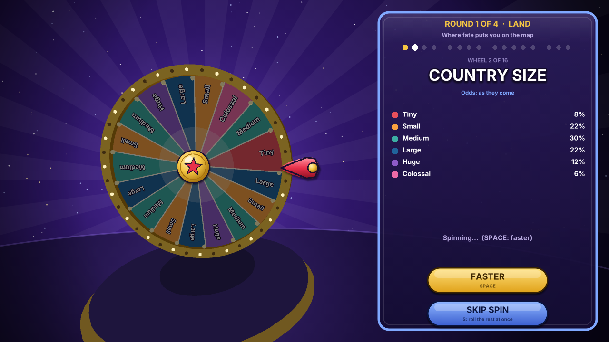
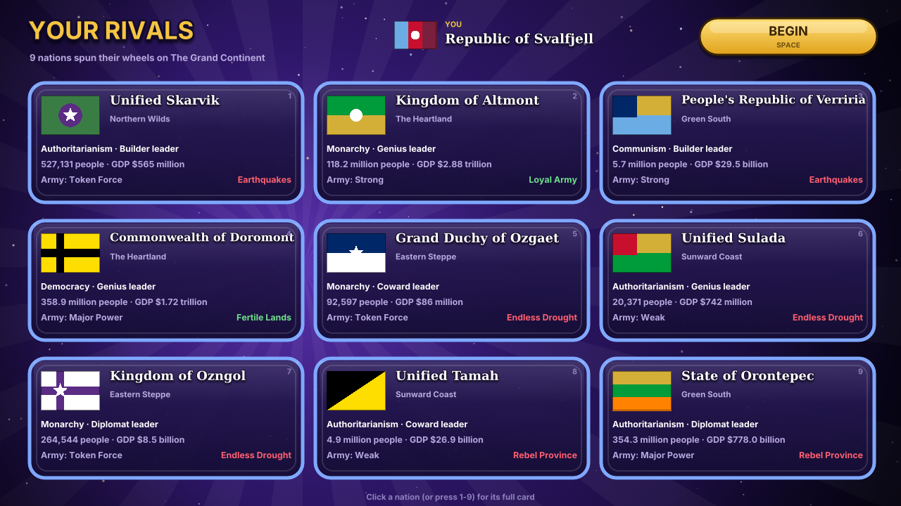

# LUCKY WORLD

A mostly-3D strategy game where fate deals your nation. At the start you spin
**16 wheels** to find out who you are: where you live, how many people you
have, how rich and how armed you are, who leads you and what luck follows
you. Then every rival nation spins the same wheels, and the game begins.

This repository holds the opening of the game: **the wheel screen**. It is
built with Duck Forge (engine), Duck Quill (art), Duck Echo (sound) and
Duck Mold (3D model).

<p>


</p>

## Run it

You need [Rust](https://rustup.rs) 1.87 or newer. From this folder:

```sh
cargo run --release
```

The first build downloads Duck Forge from GitHub and takes a few minutes;
after that it starts in seconds. Always run it **from this folder**: it reads
`data/` and `assets/` from here.

### If it runs slowly

The wheel's smooth edges are worked out on the CPU. `lucky_world.tune.json`
sets the picture quality. A running game re-reads it when you save it:

```json
{"supersample": 2, "bloom": 0}
```

- `supersample` 1 turns smoothing off and lets the graphics card draw the
  3D: fastest.
- `supersample` 2 is the default; 3 or 4 is smoother still.
- `bloom` 1 adds a real glow halo round the bulbs and the winning slice:
  pretty, but costly.

### Controls

| Screen | Keys | Mouse |
|---|---|---|
| Title | Left / Right or 1-3 choose a world, **Space** spin, **S** Skip Spin | click a world, click the buttons |
| A wheel | **Space** spin (while spinning: faster), Space again for the next wheel, **S** Skip Spin | buttons |
| Round card | **Space** next round, **S** Skip Spin | buttons |
| Country card | **Space** meet your rivals | button |
| Rivals | 1-9 or click a nation for its full card, Esc or Space back | click a card |
| Anywhere | **F5** start over (for trying it out), **Esc** quit, F12 screenshot, F10 record | |

### What happens

1. **Choose a world**: one of the 3 premade maps (The Grand Continent,
   The Thousand Isles, Five Shores).
2. **Spin 16 wheels in 4 rounds**, each round ending with a summary card:
   - **Land**: Continent, Country size, Landlocked or coastal, Land type
   - **People**: Population, Human development, Ideology, History
   - **Power**: GDP, Main resource, Army strength, Active duty, Secret service
   - **Fate**: Leader, Regional impact, Blessing or curse
3. **Your country card**, with a generated name and flag and all 16 results.
4. **The rival reveal**: the NPC nations spin the same wheels (instantly),
   and all of them are shown on one screen.

Each slice's size **is** its chance, and the panel lists the exact odds. The
wheels are linked: Continent is spun first, and later wheels follow from
earlier ones. The panel's "Linked to" line names the results that shaped
each wheel. For example:

- nobody on an island continent (the whole Thousand Isles map) is landlocked;
- population follows the country's area and land;
- GDP is population times income per person (from HDI), with a rare golden
  "Tiny but Rich!" slice that only small countries can land on;
- army strength follows GDP and population, and active duty follows how big
  the army is next to what the economy can pay for (a junta with a big army
  and a small economy puts many people in uniform); no army means 0% on duty;
- only one nation per world can have the World's Strongest army, and one
  Regional Power per continent.

**Skip Spin** rolls every wheel that's left at once, with the same odds and
links. Mid-spin it keeps the result the wheel was heading for.

## Tune the wheels

Everything about the wheels is in plain text files. Edit them and run the
game again; no rebuild is needed.

- `data/wheels.toml`: all 16 wheels: options, weights, colours, rules and
  links. Its header explains every kind of rule.
- `data/maps.toml`: the 3 maps, their continents and tags (island, cold,
  heartland...), and how many rivals each has.
- `data/names.toml`: name syllables per region, name forms per ideology
  ("Kingdom of {}"), and flag colours.

A mistake in these files is reported as one sentence naming the file and
the wheel. `cargo test` checks them too, and checks the promises above over
tens of thousands of rolled countries. To see how often each option comes
up on each map:

```sh
cargo test --release odds_report -- --ignored --nocapture
```

## The art, sound and model

| Source | Tool | Becomes |
|---|---|---|
| `art/*.json` | Duck Quill scripts | `assets/art/*.png` (pointer, hub, glow, sparkle, cards, buttons, logo, backdrop, RARE! badge) |
| `sound/*.toml` | Duck Echo recipes | `assets/sound/*.wav` (two ticks, land chime, whoosh, rare sting, card swoosh, fanfare) |
| `models/wheel_stand.toml` | Duck Mold recipe | `assets/models/wheel_stand.glb` (the stage and post) |

The wheel itself is built in code from triangles, because its slices change
with every spin. Its labels are text painted onto textures.

The built files are committed, so the game runs without the tools. To
rebuild them after changing a source, build the three tools and run:

```sh
QUILL=path/to/quill DUCK_ECHO=path/to/duck-echo DUCK_MOLD=path/to/duck-mold tools/make_assets.sh
```

## Without a screen (servers, checks, CI)

```sh
cargo test --release --no-default-features
cargo run --release --no-default-features -- --headless --inputs playthroughs/lucky_world.json --sheet-events --out out/look
cargo run --release --no-default-features -- --fuzz 40
```

The playthrough spins all 16 wheels, opens a rival's card and presses Begin.
`out/look/sheet.png` shows the run, and `audio.wav` has every tick.

## Files

| | |
|---|---|
| `src/data.rs` | Reads and checks the TOML files |
| `src/fate.rs` | The odds of each wheel given the earlier results, rolling a result |
| `src/country.rs` | A country: results, name, flag, numbers in words; rolling rivals |
| `src/wheel.rs` | The 3D wheel: slices sized by odds, labels, the spin, ticks, the glow |
| `src/game.rs` | The screens: title, wheels, round cards, country card, rivals |
| `src/ui.rs` | Loading assets, text, buttons, sparkles and confetti |
| `src/tests.rs` | Data checks, linking rules over many countries, play tests |
| `ISSUES.md` | Problems and missing features found in the four Duck tools |
