# LUCKY WORLD

A mostly-3D strategy game where fate deals your nation. At the start you spin
**16 wheels** to find out who you are: where you live, how many people you
have, how rich and how armed you are, who leads you and what luck follows
you. Then every rival nation spins the same wheels, and the game begins.

So far it has **the wheel screen** (phase 1), **the 3D world map**
(phase 2), with every nation laid on one of three hand-made maps from its
wheels, and **the economy** (phase 3): a living, daily simulation of 16
goods in production chains, jobs, wages, prices, money, budgets, debt,
currencies and world trade for every nation, on a game clock. And
**the NPC brains** (phase 4): every nation you don't run thinks for itself,
with the same levers you have, the same fog of war, and a personality from
its wheels. You can watch a world of brains only and read any one's mind.
And **war** (phase 5): divisions of soldiers and real equipment, fought
hour by hour with Lanchester's laws and dice, every shell from a real
factory (duds included), supply lines, air and sea, an escalation ladder
from border skirmish to total war, and peace deals. And **diplomacy and
spies** (phase 6): relations you can read the reasons for, treaties with
terms that can be broken, a reputation everyone sees, allies called to war,
negotiated peace, loyal or restless vassals, and secret services whose
missions succeed or fail by real odds. And **phase 7 makes it a finished
game**: a main menu, saving and loading (everything, down to every random
number), four ways to win and three to lose with a victory or defeat
screen that tells your nation's story, settings, a tutorial, tooltips on
every number, a help screen, difficulty levels, and music that follows
war and peace. It is built with Duck Forge (engine), Duck Quill
(art), Duck Echo (sound) and Duck Mold (3D models).

<p>
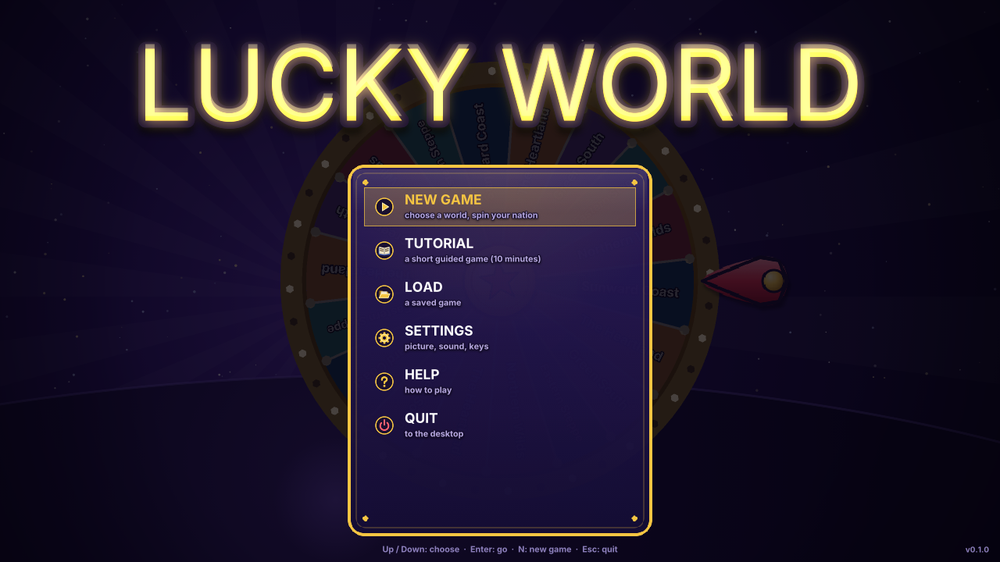
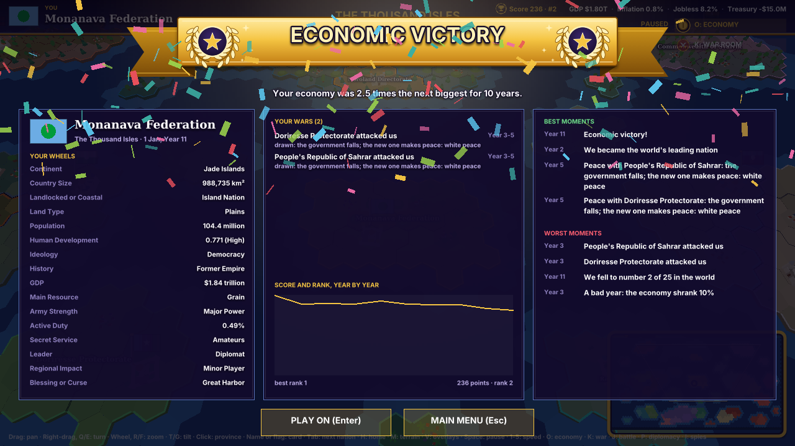
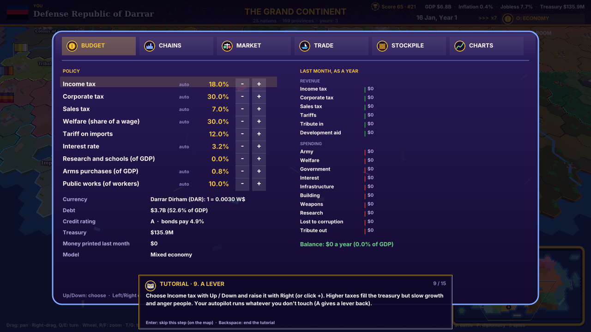
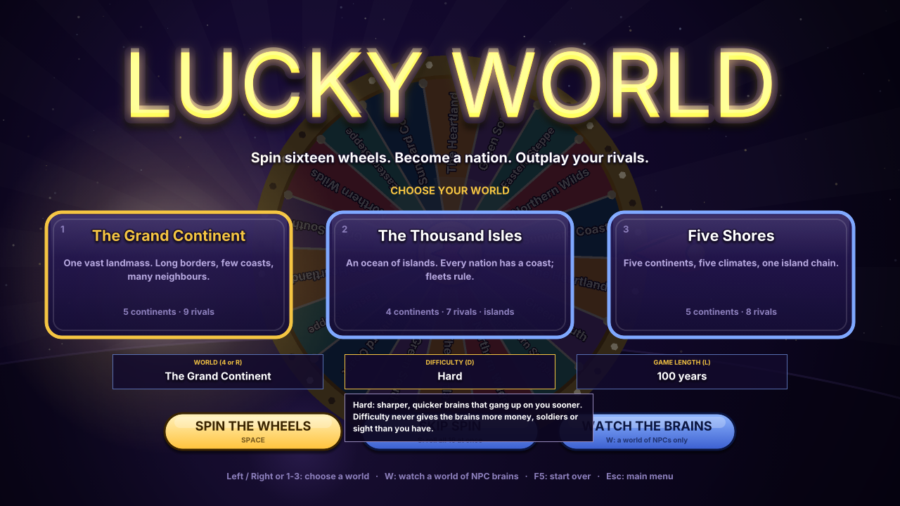
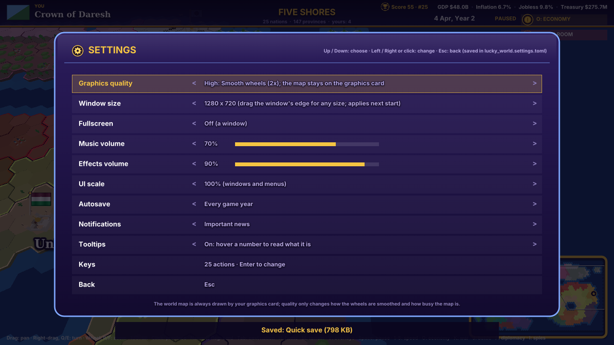
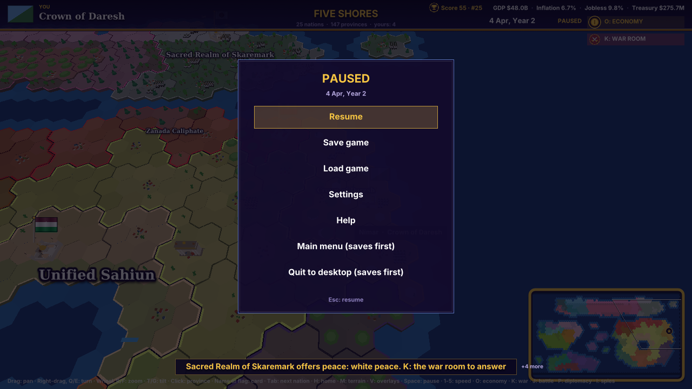
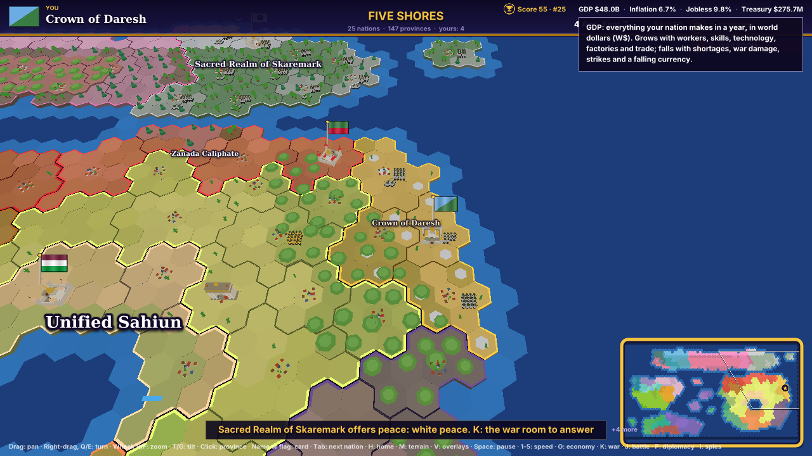
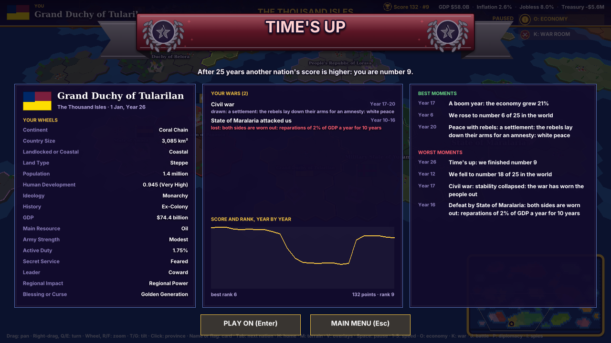
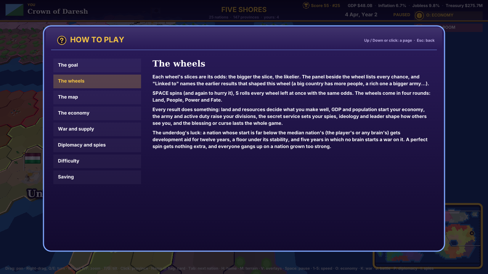


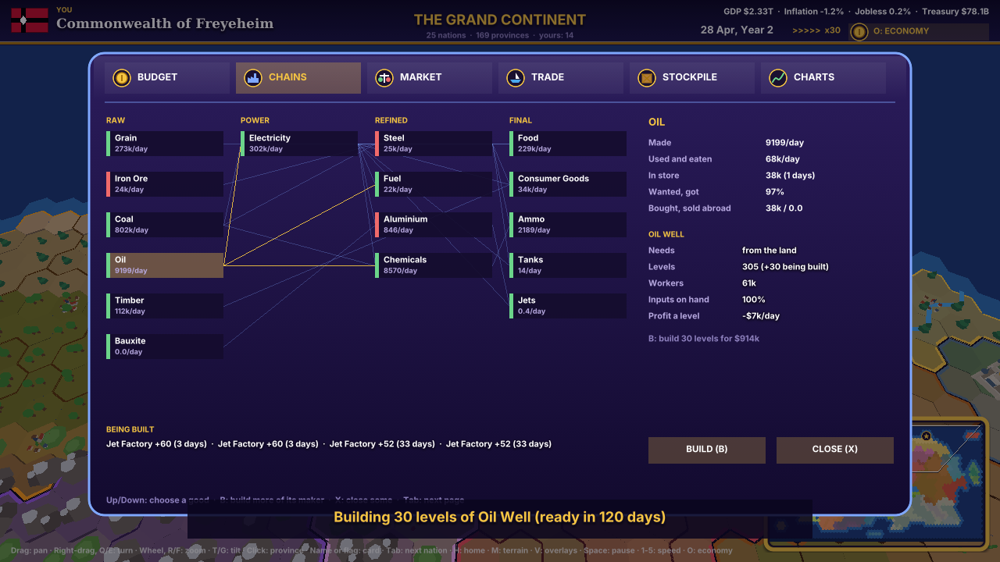


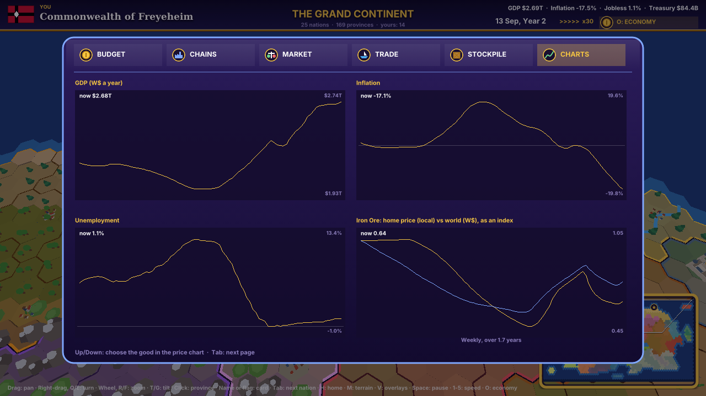


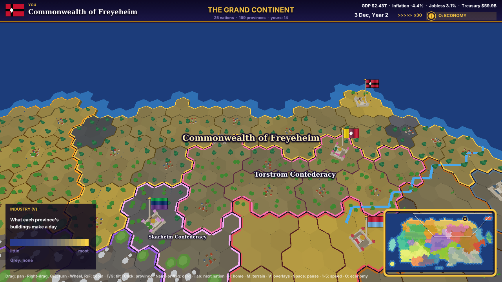
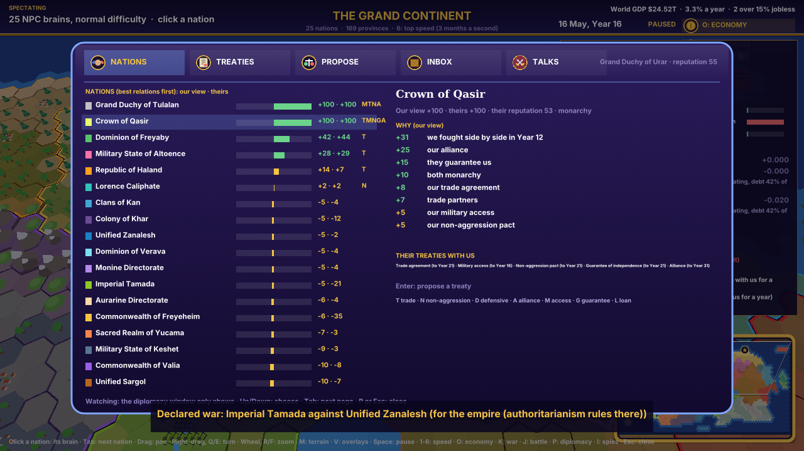
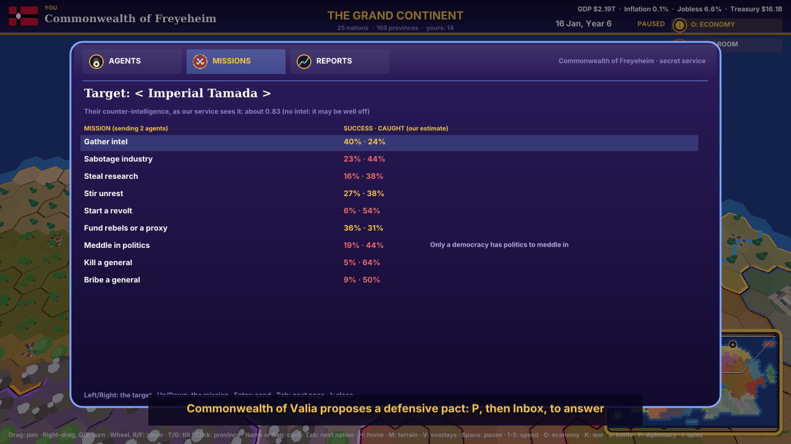

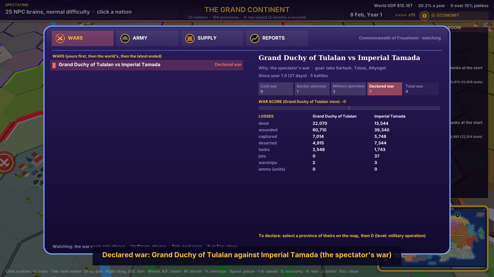
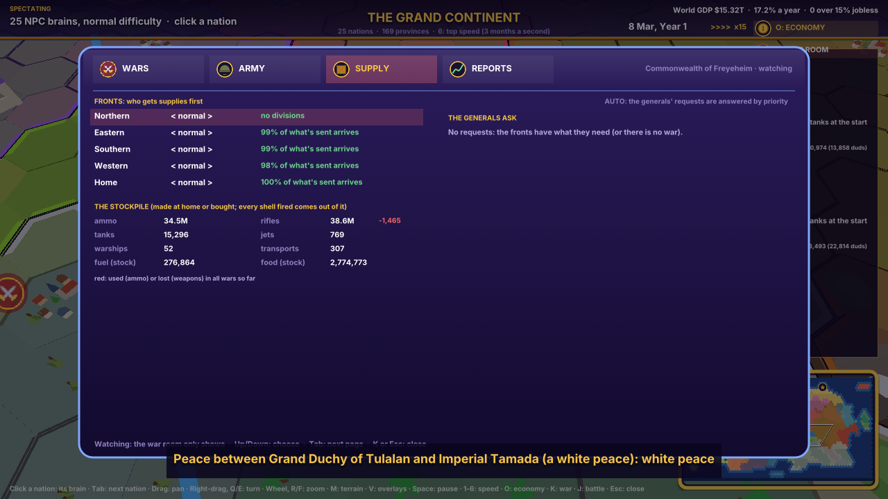
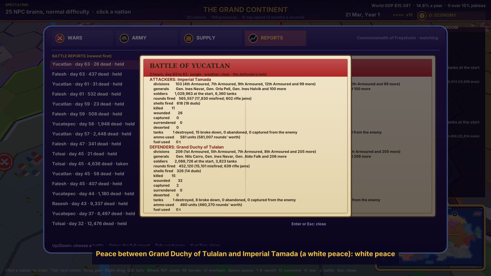


</p>

## Play it (no install)

Download a zip from [dist/](dist/), extract the whole folder (on Windows:
right-click → "Extract All...", to Desktop or Documents, not from inside the
zip), and double-click:

| | |
|---|---|
| Windows | [LuckyWorld-Windows.zip](dist/LuckyWorld-Windows.zip) → `LuckyWorld.exe` (the first time, "Windows protected your PC": More info → Run anyway; the game isn't signed) |
| Linux | [LuckyWorld-Linux.zip](dist/LuckyWorld-Linux.zip) → `LuckyWorld` |

The app reads the `data` and `assets` folders beside it, and every one of
those files is also built into the app (`build.rs`, `src/files.rs`): if
Windows or antivirus blocks a file ("Access is denied"), a read is retried
for about a second and then the built-in copy is used, and the file is
listed in `lucky-world-notes.txt`. If it still can't start, it writes why in
`lucky-world-error.txt` beside it. `HOW_TO_PLAY.txt` in the
zip explains the controls. To rebuild both zips: `tools/package.sh` (Windows is
cross-built from Linux with mingw-w64). There is no macOS build yet.

## How to play

Start the game and choose **Tutorial** on the main menu: a short guided
game (about ten minutes) that waits for you to do each thing it teaches.
Or **New Game**: choose one of the three worlds (or a random one), the
difficulty and how long the game lasts, then spin.

1. **Spin your nation.** Sixteen wheels decide where you live, how many
   you are, how rich and armed, who leads you and what luck follows you.
   Each slice's size is its chance. A very weak start gets the
   *underdog's luck* (aid, and a few years in which no brain attacks it).
2. **Rule it.** On the 3D world map the clock runs a day at a time while
   24 nations run by NPC brains do the same. Run your economy, your wars
   and their supply, your diplomacy and your spies from the buttons on the
   right, or leave any of it on autopilot. Right-click any nation for what
   you can do with it. Hover any number to read what it is and what
   changes it; **Menu → How to play** is the help.
3. **Win** by conquest (own half the map), economic power (an economy 2.5
   times the next biggest for 10 years), diplomacy (lead an alliance that
   owns 60% of the map for 5 years) or the best score when the game's
   length runs out.
   **Lose** if you're conquered, overthrown in a civil war or made a vassal;
   a vassal can play on and fight for its independence.
4. **Save** any time: **Menu** (or Esc) opens the pause menu (six save
   slots), and the game saves itself every game year and whenever you
   leave. Continue on the main menu loads your newest save.

**Difficulty** (easy, normal, hard, brutal) only changes how well the
brains plan and react: how noisy their plans are, how far ahead they look,
how many moves a week they make, how quickly they rethink, how soon they
gang up on a rising power (you) and how well they judge a war's odds. It
never gives them more money, soldiers or sight than you have.

## Run it from the source

You need [Rust](https://rustup.rs) 1.87 or newer. From this folder:

```sh
cargo run --release
```

The first build downloads Duck Forge from GitHub and takes a few minutes;
after that it starts in seconds. It reads `data/` and `assets/` from this
folder (started from anywhere else, it looks beside its executable).

### If it runs slowly

The world map is always drawn by your graphics card (it uses no CPU-only
effects). The wheel screens' smooth edges are worked out on the CPU:
**Settings → Graphics quality** Low or Medium turns that smoothing off
(everything on the graphics card), High smooths the wheels 2× (the
default), Ultra 3× with a glow. `lucky_world.tune.json` can still override
the quality for testing (a running game re-reads it):

```json
{"supersample": 1, "bloom": 0}
```

### Controls

Everything is done with the mouse. Keys are only shortcuts: hover a
button and its tooltip names its key.

**Esc never throws you out.** It closes whatever is open on top (a window,
a card, the right-click menu, the province you chose). With nothing open it
opens the pause menu, on every screen of a game, the wheels included.
Leaving to the main menu or the desktop always asks "are you sure?" first,
and saves your game before it leaves.

| Where | Mouse | Shortcuts |
|---|---|---|
| The wheels | **Spin** (or click the wheel itself); click again to hurry it; **Next wheel**; **Skip spin** rolls the rest at once. Scroll the list of every slice; hover a slice for its odds, or a greyed one for why it can't come up | Space, S |
| The map | **left-drag** moves the map, the **mouse wheel** zooms towards the pointer, **right- or middle-drag** turns and tilts it; the screen's edges scroll it in full screen; click or drag the **minimap**; **double-click** a nation to centre on it; **right-click** a nation or province: country card, diplomacy, propose a treaty, trade, send spies, declare war (asks first) | WASD or arrows, Q / E, R / F, T / G, H home, Tab next nation |
| Top bar | your nation (its country card), the five numbers (each opens its page), pause / play, speeds 1-5, **Menu** | Space, 1-5, Esc |
| Left cards | Your nation (Country card, Go home); the selected province (Build here, Details); **Needs you**: each row opens the right page | |
| Right rail | Economy, War room, Battles, Diplomacy, Spies, News log (a gold badge counts what waits) | O, K, J, P, I, L |
| Bottom | the views (Nations, Terrain, Resources, Industry, Alliances); the news strip (**Show** goes there); zoom and home by the minimap | M, V |
| Windows | tabs, rows, buttons and sliders (taxes, rates, counter-intelligence: drag them); the mouse wheel scrolls lists; the **X** or a click outside closes | Tab, Up / Down, Left / Right, Enter, Esc |
| Pause menu | Resume, Save game, Load game, Settings, How to play, Main menu, Quit to desktop | Esc, F6 quick save, F9 quick load, F2 help |
| Full screen | Settings → Fullscreen (on by default, borderless over the whole screen) | Alt+Enter |

Every map shortcut can be changed in **Settings → Shortcut keys**.

### What happens

1. **Choose a world**: one of the 3 premade maps (The Grand Continent,
   The Thousand Isles, Five Shores).
2. **Spin 16 wheels in 4 rounds**, each round ending with a summary card:
   - **Land**: Continent, Country size, Landlocked or coastal, Land type
   - **People**: Population, Human development, Ideology, History
   - **Power**: GDP, Main resource, Army strength, Active duty, Secret service
   - **Fate**: Leader, Regional impact, Blessing or curse
3. **Your country card**, with a generated name and flag and all 16 results.
4. **The rival reveal**: the map's rivals spin the same wheels (instantly),
   everyone is placed on the map, and more nations spin to fill the empty
   land, up to 25 in all. All of them are shown, on pages if needed.
5. **Begin** takes you onto **the 3D world map**: provinces, borders in each
   nation's colour, names, flags, capitals, towns, landmarks, rivers, a
   minimap, and a panel for any province you click.
6. **The clock runs**: one tick is one day. Every nation's economy lives
   (see below), news pops up, and you run yours from the economy window.

### The world

The three maps play differently:

- **The Grand Continent**: one big landmass (169 provinces), long land
  borders, a lake and two mountain ranges in the middle, a few islands.
- **The Thousand Isles**: 25 islands (94 provinces); every nation has a
  coast, and island nations have the sea all round.
- **Five Shores**: five continents and an island chain (147 provinces), from
  the frozen north to the desert of Sahrun round its Oasis Sea.

Each map is a hex grid of terrain (plains, forest, jungle, desert, steppe,
tundra, hills, mountains, marsh, glacier, lakes, shallow and deep sea),
rivers and landmarks, split into provinces. Every province knows its
terrain, whether it is on the coast, its neighbours, its rivers and its
continent; later phases build on these.

Nations are placed from their wheels:

- **Continent**: where it sits.
- **Country Size**: how many provinces, as a share of this map
  (`data/world.toml`), so "Huge" is huge for the map you play.
- **Landlocked / Coastal / Peninsula / Island Nation**: its border.
  Landlocked nations never touch the sea; island nations take a whole
  island and share no land border.
- **Land Type**: it prefers provinces of that terrain.

Island nations go first, then landlocked ones, then the rest, bigger
before smaller. The player gets no favours. When the land can't give a
nation what it rolled (no free island the right size, say), the card says
so in blue. Then extra nations roll the same 16 wheels for the biggest
empty stretch, until the land is covered or there are `max_nations`. Land
still left joins a neighbour, and stray islets join the nearest nation
across the sea.

Each slice's size **is** its chance, and the panel lists the exact odds. The
wheels are linked: Continent is spun first, and later wheels follow from
earlier ones. The panel's "Linked to" line names the results that shaped
each wheel. For example:

- nobody on an island continent (the whole Thousand Isles map) is landlocked;
- population follows the country's area and land;
- GDP is population times income per person (from HDI), with a rare golden
  "Tiny but Rich!" slice that only small countries can land on;
- army strength follows GDP and population, and active duty follows how big
  the army is next to what the economy can pay for (a junta with a big army
  and a small economy puts many people in uniform); no army means 0% on duty;
- only one nation per world can have the World's Strongest army, and one
  Regional Power per continent.

**Skip Spin** rolls every wheel that's left at once, with the same odds and
links. Mid-spin it keeps the result the wheel was heading for.

### The economy

Every nation has a real economy, simulated day by day (the full design,
with the math, is [docs/ECONOMY.md](docs/ECONOMY.md)):

- **16 goods in chains**: grain, iron ore, coal, oil, timber and bauxite are
  dug and farmed; power, steel, fuel, aluminium and chemicals are refined;
  food, consumer goods, ammo, tanks and jets are made. Buildings sit in
  provinces and need workers, skill, power and inputs; they scrap a share as
  defects. **Break a link and everything after it slows or stops.** Roads,
  rail and ports limit what each province can move.
- **People and jobs**: farming, mining, industry, services, government and
  the army; wages, unemployment, and needs for food, goods and luxuries.
  Shortages and joblessness lower happiness and stability.
- **Money and the state**: taxes in; army, welfare, government,
  infrastructure, building and weapons out. Deficits become debt with a
  credit rating; past the rating's ceiling, money is printed and the
  currency falls. A central bank sets interest rates. Each nation has its
  own currency.
- **Markets and trade**: prices from supply and demand; a world market with
  exchange rates, tariffs and embargoes; coastal nations trade cheaply by
  sea, landlocked ones pay more overland.
- **Every wheel has an economic job**: the wheels set day 1 (its GDP is the
  wheel's), the land and resources decide what a nation makes well, and the
  ideology sets the model: Communism plans (quotas, shortages), Democracy is
  a free market, the rest are mixed, and colonies pay tribute to an
  overlord. History, leader, HDI and blessing or curse all have effects, in
  `data/economy/effects.toml`.
- **Luck and rot**: booms, crashes, discoveries, bad harvests, factory fires,
  strikes, earthquakes and oil shocks; corruption and the black market.
- **Your nation runs on an autopilot** (central bank, taxes, investment,
  infrastructure, trade) until you take a lever of your own. Every other
  nation is run by its brain.

Everything is in `data/economy/*.toml` (goods, buildings, effects, events,
currencies and every constant in `settings.toml`), read when the game starts.

### The NPC brains

Every nation you don't run has a brain (the full design, with the math, is
[docs/AI.md](docs/AI.md)). It thinks in three layers:
- **Strategy**, every three months: how strong everyone is, who is its
  biggest threat, whether someone (perhaps you) is too strong for comfort,
  which weak neighbours could be opportunities, and its goal: grow, get
  rich, dominate or survive.
- **Planning**, every week: every action it could take (taxes, welfare,
  tariffs, the rate, research, arms, public works, building and closing, roads, ports,
  export bans, embargoes) gets a score for how much it helps its goal now.
  It takes the best, or holds still if nothing beats that.
- **War** (phase 5): whether to start one, how far to escalate, when to
  match or back down and when to make peace (below).

**Fair play.** A brain uses only the player's own buttons, with the same
costs and limits. It sees its own country fully, but other nations only
through its secret service, with errors (a legendary service guesses within
4%, none within 30%). There are no bonuses: difficulty is how well it plans.
**Personality** comes from the wheels: a warlord takes risks, a coward is
careful, a genius plans further ahead, a builder loves industry, a diplomat
loves trade. A democracy needs public support, military rule loves its army,
communism plans, and a colony resents its overlord. **Memory**: each brain
remembers who embargoed it, who kept trading and who cut it off, ready for
diplomacy and war.

Over 50 years on all three maps and twelve seeds (36 worlds), brains beat
the phase 3 autopilot on all three yardsticks:

| | Autopilot | Brains |
|---|---|---|
| World growth a year | 0.84% | **2.36%** |
| Nations above 15% unemployment | 426 of 900 | **203** |
| Junk credit ratings | 241 | **138** |

**Spectator mode**: press **W** on the title (or start with
`-- --spectate grand`). A world of brains only runs at up to three months a
second; click any nation to see its goal and why, its needs, its three best
options with their scores and reasons, what it did, its threats and what it
remembers.

The weights are all in `data/ai/brain.toml` and `data/ai/personality.toml`.
The tools that tuned them:

```sh
cargo run --release --no-default-features -- --ai-compare 50 1 2 3 4 5 6   # brains against the autopilot
cargo run --release --no-default-features -- --ai-tune 100 30              # 100 NPC worlds: dumb behaviour
cargo run --release --no-default-features -- --ai-trace grand 1 4 720      # one brain's weeks
```

To see how the world does without you:

```sh
cargo run --release --no-default-features -- --economy-report 50
cargo run --release --no-default-features -- --economy-report 50 --map isles --world-seed 3
```

It prints every nation's model, people, GDP then and now, growth, GDP per
head, inflation, unemployment, debt, rating, stability, trade and top export,
then the world's prices and the latest news (50 years of 25 nations take
about 4 seconds; a full run of all three maps is in
[docs/economy_report_50y.txt](docs/economy_report_50y.txt)).
`--economy-trace MAP NATION DAYS EVERY` follows one nation
day by day (`--detail`, `--budget`, `--world`, `--good ID` and `--cpi` show more).

The balance rules (no nation over $300k a head, no 5-year spell over 25%
unemployment, world inflation between -3% and 8% every year, never more than
2 nations over 15% inflation at once, no collapses) can be checked on any
seeds:

```
cargo run --release --no-default-features -- --economy-health 50 1 2 3 4 5 6 7 42 --why
cargo run --release --no-default-features -- --economy-world isles 5 600
```

(see [docs/ECONOMY.md](docs/ECONOMY.md), section 14, for the rules and the
before and after of the balance pass).

### War

Every army is made of **divisions** of 10,000 soldiers (armoured ones
with 200 tanks), raised from the active-duty wheel and the population,
each with training, experience, morale, a general (skill and style) and
an **equipped %** (rifles, ammo, food, and for tanks fuel). The full design
and the math are in [docs/WAR.md](docs/WAR.md).

- **Combat, every hour**: shots fired × accuracy × training × terrain ×
  weather × general × air × supply × morale × dice = hits; each hit is
  killed, wounded or captured. Frontage limits who can fight, so cover
  turns Lanchester's square law towards the linear one. Mountains, rivers,
  forests, marshes and cities matter a lot.
- **Every round counts**: weapons come from the economy's factories with a
  **defect rate** set by factory quality, so rifles jam, shells are duds
  and tanks break down. Every round and shell fired comes out of the
  stockpile. Morale falls with losses, shortages, bad generals, defeats
  and war exhaustion; past the breaking point divisions retreat,
  surrender or desert. Tanks without fuel are abandoned and captured.
- **Supply** runs from the capital along roads, rail and sea lanes; distance
  and enemy air cut what arrives. Generals ask for what they need in words
  ("Western front needs 200 tanks and 3 weeks of fuel"); you approve or
  deny (or leave it on Auto) and set each front's priority. Commanding the
  armies yourself is optional: the generals fight on their own.
- **Air and sea**: jets fight for air superiority (support, interdiction,
  bombing factories and rail); warships fight for sea zones, blockade,
  and carry invasions. Warships and transports are new goods built in
  coastal shipyards. Landlocked nations can't have a navy.
- **The escalation ladder**: cold war, border skirmish, military
  operation, declared war, total war, plus proxy wars, civil wars and
  blockades. Either side can escalate; the other matches or backs down.
  Military rule escalates easily; a democracy needs its people behind it.
- **Peace** by war score: white peace, reparations, provinces, a vassal or
  a new government; prisoners go home. The dead leave the population,
  ruined factories and rail must be rebuilt.
- **The brains go to war** with the same rules and the same fog: warlords
  and military rule are aggressive, cowards and democracies avoid war, and
  everyone gangs up on whoever gets too strong, you included.

Over 50 years on all three maps and six seeds (18 worlds, 450 nations),
after the war balance pass (before → after; the whole comparison is in
[docs/WAR.md](docs/WAR.md), section 14):

| | Before | After |
|---|---|---|
| Border skirmish | 0.24 years | **0.11** (weeks) |
| Military operation | 0.27 years | **0.79** (months) |
| Declared war | 0.10 years | **1.24** (longest 5.8) |
| Total war | 0.12 years | **3.18** (longest 4.8) |
| Captured ÷ killed | 4.5 | **1.0** |
| Civil wars | 0 | **63** (3.5 a world) |
| Causes of war | weakness 463, grudge 12 | weakness 225, ideology 163, grudge 157, resources 133, civil 63, independence 62, coalition 42 |
| Vassals made / broke free | 87 / 0 | 27 / 20 |
| Most nations at declared or total war at once | 16% | 32% |

- **Morale**: a broken division retreats and regroups, breaks out of an
  encirclement, and a pocket fights on until its morale or supplies are
  gone. Defenders dig in; attackers that outnumber them spread round the
  flanks, and big armies attack on many fronts instead of piling into one
  province.
- **Why wars start**: weakness, grudges remembered, spreading an ideology
  (the revolution, a holy war), a resource it has to import, land lost in
  a peace deal, and coalitions of up to four against a nation grown too
  strong, the player included.
- **Vassals** cost their overlord output and stability, want their
  freedom more the longer and the weaker their overlord, and fight wars of
  independence; an overlord holds at most three, and vassals hold none.
- **Civil wars** come from war exhaustion, lost wars, occupation, famine,
  unemployment, debt crises and an empire's burden.

```sh
cargo run --release --no-default-features -- --war-report 50 1 2 3 4 5 6 --battles   # every war, and the bloodiest battle of each world
cargo run --release --no-default-features -- --war-battle grand 1                    # one battle, hour by hour (add "sea" for an invasion)
cargo run --release --no-default-features -- --war-world isles 2 20                  # one world's wars
cargo run --release --no-default-features -- --spectate-war grand                    # watch a war from the first shot to the peace
```

The full 50-year report is [docs/war_report_50y.txt](docs/war_report_50y.txt).

### Diplomacy and spies

The full design, with the math, is [docs/DIPLOMACY.md](docs/DIPLOMACY.md).

- **Relations** between every pair are rebuilt each month from their
  reasons, and the game shows them: "+12 trade partners · −30 they invaded
  us in Year 14". Ideology, borders, trade, treaties, reputation, threats,
  and a memory of wars, broken words, calls answered or refused, spies
  caught, embargoes, arms sold and loans.
- **Treaties**: trade agreements (no tariffs, partners' goods preferred in
  the market), non-aggression pacts, defensive pacts, alliances, military
  access, guarantees of independence, arms deals, loans with interest, and
  sanctions. Each has terms and a duration, and can be broken: attacking a
  partner, refusing a call to arms, defaulting on a loan.
- **Reputation**: breaking a deal costs it with everyone, and every answer
  weighs it, so liars get fewer deals. Every answer says why: "No: you
  broke a pact with our ally".
- **Alliances in war**: allies are called and decide by their honour,
  relations and the odds; coalitions against the strongest become formal
  alliances. **Peace talks**: offers and counteroffers, week by week, each
  side judging the war score through its own spies; allies take their share.
- **Vassals** have a loyalty that protection raises and neglect ruins;
  under 25, an independence movement grows.
- **Spies**: the Secret service wheel sets each service; agents train,
  cost money and can be caught. Nine missions (intel, sabotage, stealing
  research, unrest, revolts, funding rebels, meddling in a democracy,
  killing or bribing a general), each at odds of agent skill against the
  target's counter-intelligence plus luck. A caught spy is a diplomatic
  incident. Spies never show more than their intel buys: the chances you
  see are your own service's estimate.
- **The brains** use all of it with their personality: diplomats love
  treaties, warlords break them, cowards seek protection, communists and
  theocrats prefer their own.

Over 50 years on all three maps and six seeds (18 worlds, 450 nations), the
full game with diplomacy and spies against the same worlds without them:

| | Without diplomacy | With diplomacy |
|---|---|---|
| World GDP growth a year | 2.47% (worlds 1.17% to 3.44%) | **2.55%** (1.61% to 3.31%) |
| Wars (a nation per decade) | 848 (0.38) | **631** (0.28) |
| Soldiers killed | 60.3M | **27.6M** |
| Total wars (average length) | 48 (3.09 years) | **20 (2.55 years)** |
| Declared wars (average length) | 330 (1.24 years) | 253 (1.18 years) |
| Civil wars | 63 | 74 |
| Wars held back by treaties or deterrence (pair-years) | | 2,111 |
| Wars ended by negotiation | | 315 |

- **Treaties**: 22,182 signed (5,224 non-aggression, 5,022 trade, 4,828
  military access, 2,152 guarantees, 1,911 defensive pacts, 1,635
  alliances, 800 loans, 548 arms deals, 62 sanctions) and 111 broken (29
  non-aggression pacts by attacks, 26 alliances and 22 guarantees by
  refused calls, 29 loans by defaults). 153 alliances came out of
  coalitions against a hegemon.
- **Calls to arms**: 869 honoured, 18 refused (an alliance's offensive
  call declined 7 more times).
- **Peace talks**: 317 opened, 374 rounds, 315 deals; allies took their
  share of reparations 301 times.
- **Spies**: 34,396 missions (13,745 to steal research, 9,111 for intel,
  8,563 sabotage, 2,035 meddling, 870 funding rebels or a proxy, 72
  revolts), 26,347 succeeded; 4,557 agents caught in 4,097 diplomatic
  incidents; 38 revolts started.
- **Vassals**: 69 independence movements.
- **Money and arms**: $417B lent (658 loans repaid), $1.14T of arms sold.

```sh
cargo run --release --no-default-features -- --diplomacy-report 50 1 2 3 4 5 6 --compare
```

### A finished game (phase 7)

The full design is [docs/PHASE7.md](docs/PHASE7.md).

- **Saving**: everything is saved (the wheels, the map, the economy, every
  brain and its memory, the wars, treaties, spies, and every random
  number generator's exact state), compressed, with a version number up
  front: a save from another version is listed with the reason it can't be
  loaded, never a crash. A test runs each map to day 400, saves, loads,
  and runs 500 more days: byte for byte the same world as one that never
  saved.
- **Winning and losing**: `data/victory.toml` (the shares, the lead, the
  years, the score's weights, the game lengths and the underdog rule).
  The result screen tells the story: your wheels, your wars, your score
  year by year, your best and worst moments.
- **Learning**: a 15-step tutorial, tooltips (`data/tips.toml`) on the top
  bar, the budget, the market, the stockpile, the war room, diplomacy,
  the spies and the province panel, a help screen (`data/help.toml`), and
  notifications that queue instead of piling up (the same news twice in
  30 seconds is dropped; Settings choose how much pops up).
- **Settings**: graphics quality, window size, fullscreen, music and
  effects volumes, UI scale, autosave, notifications, tooltips, and every
  map key.
- **Sound**: a menu theme, a peace theme and the war drums that crossfade
  with war and peace, and a sound for saving, refusals, treaties, war,
  peace, building, spies and menu moves.
- **Difficulty**: easy, normal, hard, brutal (`[difficulty.*]` in
  `data/ai/brain.toml`): planning noise, how far ahead, moves a week, how
  quickly the brains rethink, how soon they gang up on a rising power, how
  well they judge a war's odds, and how often they look for one. Normal is
  the brains of phases 4-6 unchanged.

**The player test** (`src/player_test.rs`, with the bot in `src/bot.rs`)
plays a whole game headless by its keys, as a person would: the menu and
the settings, a new game on hard, spinning, a tax raised, a building
ordered, trade policy, a trade agreement and an alliance proposed, war
declared on a neighbour and peace made, the help, the notification log, a
save and a load, then on to the game's end (a win or a loss), playing on,
the main menu and Continue, checking each step and that nothing failed. A
second test walks the whole tutorial. The same bot takes these screenshots
(`--tour`).

**Balance** (`--balance 30 20`: 90 worlds, every one of their 2,250
nations a start, run by brains for 20 years, with and without the underdog
rule; the full output is [docs/phase7_balance.txt](docs/phase7_balance.txt)):

| Start (share of the median nation's GDP and soldiers) | Starts | Still free after 20 years | Rank then → now | Won within 20 years |
|---|---|---|---|---|
| terrible (under 0.25) | 697 | 90% (89% without the underdog rule) | 15.0 → 14.8 | 0% |
| poor (0.25-0.5) | 180 | 91% | 18.2 → 17.8 | 0% |
| below the median | 203 | 95% | 17.3 → 17.3 | 0% |
| above the median | 313 | 94% | 15.9 → 16.2 | 0% |
| strong (2-5×) | 247 | 96% | 13.1 → 13.2 | 0% |
| giant (5× and more) | 610 | 100% | 6.2 → 6.4 | 3% |

- **A terrible spin is playable**: none of the 697 was wiped out in 20
  years, 90% were still free (not vassals), and 46% climbed the ranking
  (44% without the underdog rule: its help is real but modest).
- **A perfect spin isn't an automatic win**: of the 90 nations that were
  the strongest in their world on day one, 72% were still first after 20
  years and 18% had won. Before this pass it was 41%: the diplomatic win
  counted defensive pacts as an alliance and came too easily (55 wins in
  90 worlds); now it needs real alliances held for 5 years, and the
  economic win 2.5× the next economy (it was 2×).

**Every wheel result does something** (`--wheel-effects`, in
[docs/phase7_wheel_effects.txt](docs/phase7_wheel_effects.txt)): every
option of every wheel was landed on one nation with everything else the
same, on all three maps, and compared with the wheel's other options on
day one. All 108 results that came up change the economy, the war,
diplomacy or the brain's personality, through modifiers, divisions,
relations and traits, not just their labels. **None does nothing.** The
109th, "0% active duty", never came up in the test: it only comes with
"No Army" (the wheels are linked), and its effect is No Army's.

**Long games** (`--long-game 100 1`: a 100-year game on each map, the
player on autopilot among 24 brains, one core;
[docs/phase7_long_game.txt](docs/phase7_long_game.txt)). Top speed is 30
days a second, so a day may take 33 ms on average:

| | Grand Continent | Thousand Isles | Five Shores |
|---|---|---|---|
| A game year, years 1-10 → the last 10 | 863 → 1,162 ms | 643 → 813 ms | 515 → 1,001 ms |
| Slowest year (headroom at top speed) | 7.6 ms a day (4.4×, year 1) | 4.5 ms a day (7.5×) | 3.1 ms a day (10.8×) |
| Worst single day | 45 ms | 15 ms | 68 ms |
| Memory (the whole program) | 19 → 43 MB | 109 → 115 MB | 116 MB |
| Save after 100 years (on disk) | 12.6 MB | 12.6 MB | 13.5 MB |
| Five more years with / without the old history | 817 / 826 ms | 996 / 923 ms | 782 / 839 ms |

- **Fast at top speed for all 100 years**: never under 4× the speed it
  needs, never a crash.
- **It doesn't slow down as history grows**: the last row runs the same
  world on with and without its old battle reports, spy reports and news,
  and the time is the same (within ±8%). The last decades cost more because
  the armies grew with the economies (Five Shores went from 994 to 2,548
  divisions), not because of the past. Two fixes on the way: the war's
  hourly checks no longer search every war ever fought, and diplomacy's
  defender search uses only live treaties.
- **The autosave** costs about 12 ms on the game's thread; compressing and
  writing the ~13 MB happen on another thread. Loading takes well under a
  second.
- One day in a few thousand takes longer than 33 ms (a big battle day);
  at top speed that's a stutter of a frame or two, not a slowdown.

```sh
cargo run --release --no-default-features -- --balance 30 20       # thousands of starts
cargo run --release --no-default-features -- --wheel-effects 1 2 3  # what every wheel result changes
cargo run --release --no-default-features -- --long-game 100 1      # 100 years on each map, year by year
cargo run --release --no-default-features -- --tour out/tour 25     # the bot plays and takes screenshots
```

## Tune the wheels

Everything about the wheels is in plain text files. Edit them and run the
game again; no rebuild is needed.

- `data/wheels.toml`: all 16 wheels: options, weights, colours, rules and
  links. Its header explains every kind of rule.
- `data/maps.toml`: the 3 maps, their continents and tags (island, cold,
  heartland...), and how many rivals each has.
- `data/names.toml`: name syllables per region, name forms per ideology
  ("Kingdom of {}"), and flag colours.

## Edit the maps

The maps are plain text too, read when the game starts (no rebuild):

- `data/maps/<map>.txt`: the terrain, one letter per hex. Odd rows sit half
  a hex to the right. The letters are in `data/terrain.toml`, with each
  terrain's colour, height, Land Type and decoration (trees, palms,
  peaks...).
- `data/maps/<map>.toml`: the provinces. Each is a name, a continent and
  the hex it is centred on (`at = [column, row]`). Every land hex belongs to
  the province nearest it over land, so moving `at` moves the borders, and
  adding a province splits its neighbours. The file also holds the rivers
  (a line of hexes ending in water) and the landmarks.
- `data/world.toml`: `max_nations` (25), the province share for each
  Country Size, the placement weights and the border colours.

A mistake (a letter that isn't a terrain, a province centred in the sea, a
continent the map doesn't have, a river that jumps) is one sentence with the
file, line and column. `tools/sketch_maps.py` is the sketch the maps were
first drawn from. Running it again overwrites them, so edit the map files
instead.

A mistake in these files is reported as one sentence naming the file and
the wheel. `cargo test` checks them too, and checks the promises above over
tens of thousands of rolled countries. To see how often each option comes
up on each map:

```sh
cargo test --release odds_report -- --ignored --nocapture
```

## The art, sound and model

| Source | Tool | Becomes |
|---|---|---|
| `art/*.json` | Duck Quill scripts | `assets/art/*.png` (pointer, hub, glow, sparkle, cards, buttons, logo, backdrop, RARE! badge; map: top bar, province panel, minimap frame, small cards, flag cloth and pole, capital, town, landmark and river icons; economy: the window and its six page icons; war: crossed swords, plane and army icons, the battle report's paper; diplomacy: handshake, spy and treaty icons; phase 7: the menu panel, victory and defeat banners, play, save, load, gear, help, quit, book, bell and trophy icons) |
| `sound/*.toml` | Duck Echo recipes | `assets/sound/*.wav` (two ticks, land chime, whoosh, rare sting, card swoosh, fanfare; map: a seamless sea-and-wind ambience loop, click, select, open-map swell, zoom tick; economy: coin, month chime, news sting; war: gunfire, an explosion, a 12-second war-drum loop; phase 7: a 16-second menu theme and a 20-second peace theme (both seamless loops), victory and defeat jingles, and save, denied, treaty, declare, peace, build, spy and menu-move sounds) |
| `models/*.toml` | Duck Mold recipes | `assets/models/*.glb` (the wheel's stand; capital, town, tree, pine, palm, cactus, peak, hill, reeds; landmarks: lighthouse, pyramid, great tower, temple, arch, colossus; war: soldier, tank, jet, warship and transport, each with one part in the nation's colour) |

The wheel itself is built in code from triangles, because its slices change
with every spin. Its labels are text painted onto textures.

The built files are committed, so the game runs without the tools. To
rebuild them after changing a source, build the three tools and run:

```sh
QUILL=path/to/quill DUCK_ECHO=path/to/duck-echo DUCK_MOLD=path/to/duck-mold tools/make_assets.sh
```

## Without a screen (servers, checks, CI)

```sh
cargo test --release --no-default-features
cargo run --release --no-default-features -- --headless --inputs playthroughs/lucky_world.json --sheet-events --out out/look
cargo run --release --no-default-features -- --headless --inputs playthroughs/economy.json --sheet-events --out out/economy
cargo run --release --no-default-features -- --headless --inputs playthroughs/spectator.json --sheet-events --out out/spectator
cargo run --release --no-default-features -- --headless --inputs playthroughs/war.json --sheet-events --out out/war --spectate-war
cargo run --release --no-default-features -- --headless --inputs playthroughs/war_player.json --sheet-events --out out/war_player
cargo run --release --no-default-features -- --headless --inputs playthroughs/diplomacy.json --sheet-events --out out/diplomacy
cargo run --release --no-default-features -- --fuzz 40
cargo run --release --no-default-features -- --economy-report 50
```

The playthrough spins all 16 wheels and opens a rival's card. It presses
Begin, then on the map it visits nations, clicks a province, opens and closes
a country card, pans, zooms, tilts and switches views. The fuzz runs reach
the map too. The economy playthrough runs the clock at full speed, opens
every page of the economy window, raises a tax, builds, and shows both
overlays. The spectator playthrough watches a world of brains for seven
years at top speed and opens five nations' brain panels. The war
playthrough watches a declared war from the first shot to the peace: it
zooms into the biggest battle, opens every page of the war room, reads a
battle report and shows the war overlay. The player's war playthrough
clicks a neighbour, declares war, orders every front to attack, turns
supply Auto off, approves a general's request, reads a report and offers
peace. The diplomacy playthrough opens every page of the diplomacy and spy
windows, gets two answers with their reasons, signs a pact from the inbox,
trains an agent, sends a mission, and shows the alliance and relations
overlays. For the map's, the
economy's and spectator mode's own keys:
`-- --fuzz 40 --fuzz-keys S,Space,Enter,Left,Right,Up,Down,Tab,M,H,C,Q,E,R,F,T,G,W,A,D,O,V,B,X,P,Digit1,Digit5,Digit6,Escape`; with the war's keys too:
`--fuzz-keys S,Space,Enter,Left,Right,Up,Down,Tab,M,H,C,O,V,K,J,E,B,P,I,Y,N,D,L,A,G,U,T,R,F,X,Digit5,Digit6,Escape` (P and I open diplomacy and spies).
`out/look/sheet.png` shows the run, and `audio.wav` has every tick.

## Files

| | |
|---|---|
| `src/data.rs` | Reads and checks the TOML files |
| `src/fate.rs` | The odds of each wheel given the earlier results, rolling a result |
| `src/country.rs` | A country: results, name, flag, numbers in words; rolling rivals |
| `src/wheel.rs` | The 3D wheel: slices sized by odds, labels, the spin, ticks, the glow |
| `tools/package.sh` | Builds the Windows and Linux apps and zips them into `dist/` |
| `src/game.rs` | The screens: title, wheels, round cards, country card, rivals |
| `src/game/map_screen.rs` | The world map screen: camera keys and mouse, picking, names and flags, province panel, minimap |
| `src/game/econ_screen.rs` | The clock, the economy window (budget, chains, market, trade, stockpile, charts), the map overlays |
| `src/game/brain_panel.rs` | Spectator mode's brain panel |
| `src/game/war_screen.rs` | War on the map: armies, fronts, arrows, battle markers and the live battle panel, the war room (wars, army, supply, reports), battle report cards, war sounds |
| `src/war/` | The war, which never draws: `data.rs` (reading `data/war/war.toml`), `mod.rs` (divisions, generals, wars, the daily loop), `land.rs` (hourly combat, moving, occupying, the generals), `supply.rs` (supply lines, requests, recruits, hospitals, desertion), `air.rs`, `sea.rs` (zones, fleets, blockades, invasions), `escalation.rs` (the ladder, exhaustion, civil, proxy and cold wars, the brains' war decisions), `peace.rs` (war score, terms, the `PeaceTable` hook), `player.rs` (the war room's commands), `report.rs` (battle reports, `--war-report`), `tests.rs` |
| `data/war/war.toml` | Every number of the war, each explained in docs/WAR.md |
| `src/diplo/` | Diplomacy and spies, which never draw: `data.rs` (reading `data/diplomacy/diplomacy.toml`), `mod.rs` (treaties, memory, relations and their reasons, reputation, the daily loop), `treaties.rs` (what a deal is worth and why, signing, breaking, loans, arms deals, sanctions, the brains' deals), `alliances.rs` (calls to arms, coalitions, vassals, the war's hooks), `talks.rs` (peace talks), `spies.rs` (services, missions, odds, incidents), `report.rs` (`--diplomacy-report`), `tests.rs` |
| `src/game/diplo_screen.rs` | The diplomacy window (nations, treaties, propose, inbox, talks) and the spy window (agents, missions, reports) |
| `data/diplomacy/diplomacy.toml` | Every number of diplomacy and spies, each explained in docs/DIPLOMACY.md |
| `docs/DIPLOMACY.md` | Diplomacy's design, with the math, and the 50-year results |
| `docs/WAR.md` | The war's design, with the math, and the 50-year results |
| `src/ai/` | The NPC brains, which never draw: `data.rs` (reading `data/ai/`), `mod.rs` (personality, brains, the daily loop), `strategy.rs` (intel, power, threats, hegemon, opportunities, the goal), `planning.rs` (needs, actions, scores, acting through the player's levers), `memory.rs` (relations, war memories), `battle.rs` (an old hook; the war's generals are in `src/war/land.rs`), `report.rs` (compare, tune, trace), `tests.rs` |
| `docs/AI.md` | The brains' design, with the math, and the before and after |
| `src/econ/` | The economy, which never draws: `data.rs` (reading `data/economy/`), `init.rs` (day 1), `tick.rs` (one day), `market.rs` (world trade), `policy.rs` (events and the autopilot), `player.rs` (the player's levers), `report.rs` (the report), `tests.rs` (its promises) |
| `docs/ECONOMY.md` | The economy's design, with the math |
| `src/hex.rs` | Hex grid maths: neighbours, corners, which hex a point is in |
| `src/mapdata.rs` | Reads and checks the maps; works out provinces, coasts, neighbours, rivers, landmasses |
| `src/world.rs` | Who owns what: placing nations from their wheels, filling the land |
| `src/map_view.rs` | The 3D map's meshes (terrain, sea, borders, rivers, trees, cities), the orbit camera, picking |
| `src/ui.rs` | Loading assets, text, buttons, sparkles and confetti |
| `src/tests.rs` | Data checks, linking rules over many countries, map and placement rules, play tests |
| `src/game/shell.rs` | Phase 7: the main menu, the pause menu, Load, Settings, Help, the victory and defeat screens, notifications, music, tooltips, the UI scale, saving and loading from the game |
| `src/game/tutorial.rs` | The tutorial's 15 steps |
| `src/save.rs`, `src/save_codec.rs` | The save file (version, summary, the game), autosaves, slots; how `Rng` and colours are saved; the save tests |
| `src/sim.rs` | The running world (economy, brains, war, diplomacy) made and stepped one day at a time, for the game, the tests and the tools |
| `src/victory.rs` | Wins, losses, the score, and the story (`Fate`) |
| `src/econ/underdog.rs` | The underdog rule |
| `src/settings.rs`, `src/fullscreen.rs` | The settings file and the map's keys; fullscreen through the window system |
| `src/bot.rs`, `src/player_test.rs` | The bot that plays by its keys, the player test, the tutorial test, `--tour` |
| `src/balance.rs` | `--balance`, `--wheel-effects`, `--long-game` |
| `data/victory.toml`, `data/help.toml`, `data/tips.toml` | How to win and lose and the underdog rule; the help pages; the tooltips |
| `docs/PHASE7.md` | Phase 7's design |
| `ISSUES.md` | Problems and missing features found in the four Duck tools |
