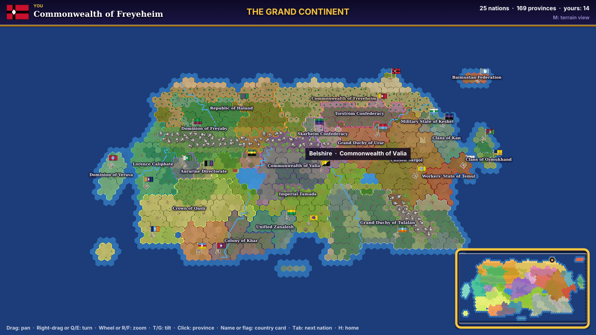
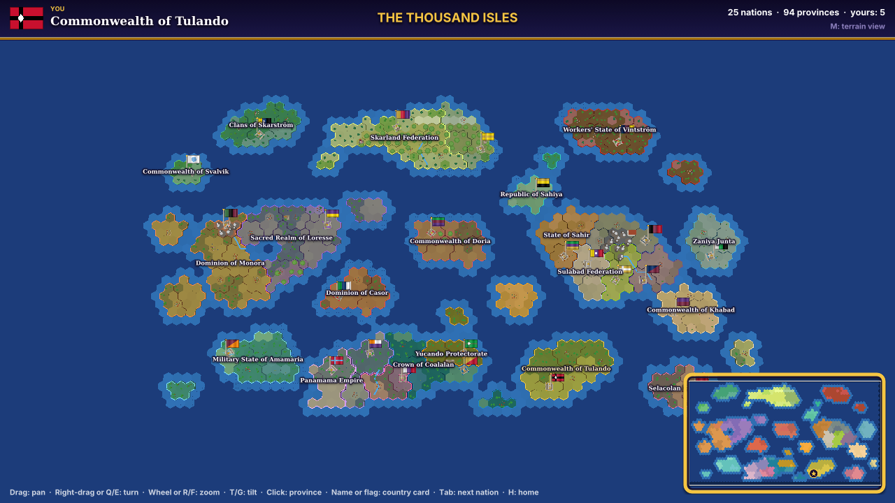
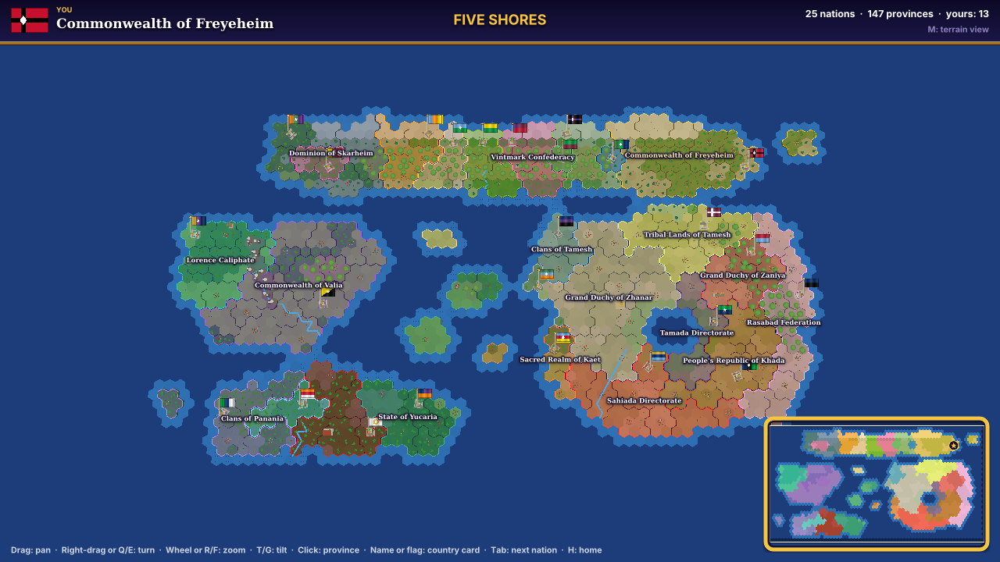
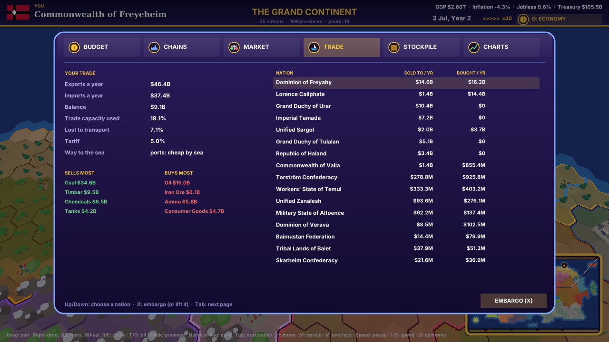
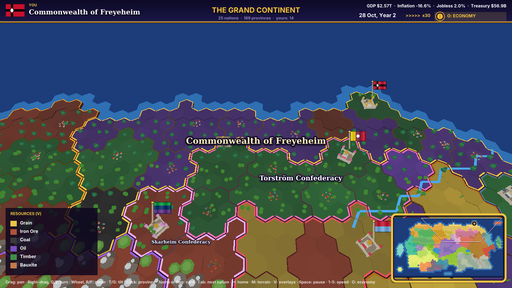

# LUCKY WORLD

A mostly-3D strategy game where fate deals your nation. At the start you spin
**16 wheels** to find out who you are: where you live, how many people you
have, how rich and how armed you are, who leads you and what luck follows
you. Then every rival nation spins the same wheels, and the game begins.

So far it has **the wheel screen** (phase 1), **the 3D world map**
(phase 2), with every nation laid on one of three hand-made maps from its
wheels, and **the economy** (phase 3): a living, daily simulation of 16
goods in production chains, jobs, wages, prices, money, budgets, debt,
currencies and world trade for every nation, on a game clock. War and
diplomacy come later. It is built with Duck Forge (engine), Duck Quill
(art), Duck Echo (sound) and Duck Mold (3D models).

<p>












</p>

## Run it

You need [Rust](https://rustup.rs) 1.87 or newer. From this folder:

```sh
cargo run --release
```

The first build downloads Duck Forge from GitHub and takes a few minutes;
after that it starts in seconds. Always run it **from this folder**: it reads
`data/` and `assets/` from here.

### If it runs slowly

The world map is drawn by your graphics card (it uses no CPU-only
effects). The wheel screen's smooth edges are worked out on the CPU. `lucky_world.tune.json`
sets the picture quality. A running game re-reads it when you save it:

```json
{"supersample": 2, "bloom": 0}
```

- `supersample` 1 turns smoothing off and lets the graphics card draw the
  3D: fastest.
- `supersample` 2 is the default; 3 or 4 is smoother still.
- `bloom` 1 adds a real glow halo round the bulbs and the winning slice:
  pretty, but costly.

### Controls

| Screen | Keys | Mouse |
|---|---|---|
| Title | Left / Right or 1-3 choose a world, **Space** spin, **S** Skip Spin | click a world, click the buttons |
| A wheel | **Space** spin (while spinning: faster), Space again for the next wheel, **S** Skip Spin | buttons |
| Round card | **Space** next round, **S** Skip Spin | buttons |
| Country card | **Space** meet your rivals | button |
| Rivals | 1-9 or click a nation for its full card, Esc or Space back, Left / Right turn pages, **Space** Begin | click a card |
| World map | WASD / arrows pan, Q / E turn, R / F zoom, T / G tilt, Tab next nation, H home, M terrain / nations view, **V** resources / industry overlay, C country card, Esc deselect | drag pans, right-drag turns, wheel zooms, click a province, click a name or flag for its country card, click the minimap to jump |
| The clock (map) | **Space** pause, **1-5** speed (1, 3, 7, 15 or 30 days a second) | |
| Economy window (map) | **O** open / close, **Tab** next page, Up / Down choose a row; Budget: Left / Right lower / raise, **A** back to autopilot; Chains: **B** build, **X** close; Market: **T** trade policy; Trade: **X** embargo | click the ECONOMY button, the pages, rows, −/+ and the buttons |
| Anywhere | **F5** start over (for trying it out), **Esc** quit, F12 screenshot, F10 record | |

### What happens

1. **Choose a world**: one of the 3 premade maps (The Grand Continent,
   The Thousand Isles, Five Shores).
2. **Spin 16 wheels in 4 rounds**, each round ending with a summary card:
   - **Land**: Continent, Country size, Landlocked or coastal, Land type
   - **People**: Population, Human development, Ideology, History
   - **Power**: GDP, Main resource, Army strength, Active duty, Secret service
   - **Fate**: Leader, Regional impact, Blessing or curse
3. **Your country card**, with a generated name and flag and all 16 results.
4. **The rival reveal**: the map's rivals spin the same wheels (instantly),
   everyone is placed on the map, and more nations spin to fill the empty
   land, up to 25 in all. All of them are shown, on pages if needed.
5. **Begin** takes you onto **the 3D world map**: provinces, borders in each
   nation's colour, names, flags, capitals, towns, landmarks, rivers, a
   minimap, and a panel for any province you click.
6. **The clock runs**: one tick is one day. Every nation's economy lives
   (see below), news pops up, and you run yours from the economy window.

### The world

The three maps play differently:

- **The Grand Continent**: one big landmass (169 provinces), long land
  borders, a lake and two mountain ranges in the middle, a few islands.
- **The Thousand Isles**: 25 islands (94 provinces); every nation has a
  coast, and island nations have the sea all round.
- **Five Shores**: five continents and an island chain (147 provinces), from
  the frozen north to the desert of Sahrun round its Oasis Sea.

Each map is a hex grid of terrain (plains, forest, jungle, desert, steppe,
tundra, hills, mountains, marsh, glacier, lakes, shallow and deep sea),
rivers and landmarks, split into provinces. Every province knows its
terrain, whether it is on the coast, its neighbours, its rivers and its
continent; later phases build on these.

Nations are placed from their wheels:

- **Continent**: where it sits.
- **Country Size**: how many provinces, as a share of this map
  (`data/world.toml`), so "Huge" is huge for the map you play.
- **Landlocked / Coastal / Peninsula / Island Nation**: its border.
  Landlocked nations never touch the sea; island nations take a whole
  island and share no land border.
- **Land Type**: it prefers provinces of that terrain.

Island nations go first, then landlocked ones, then the rest, bigger
before smaller. The player gets no favours. When the land can't give a
nation what it rolled (no free island the right size, say), the card says
so in blue. Then extra nations roll the same 16 wheels for the biggest
empty stretch, until the land is covered or there are `max_nations`. Land
still left joins a neighbour, and stray islets join the nearest nation
across the sea.

Each slice's size **is** its chance, and the panel lists the exact odds. The
wheels are linked: Continent is spun first, and later wheels follow from
earlier ones. The panel's "Linked to" line names the results that shaped
each wheel. For example:

- nobody on an island continent (the whole Thousand Isles map) is landlocked;
- population follows the country's area and land;
- GDP is population times income per person (from HDI), with a rare golden
  "Tiny but Rich!" slice that only small countries can land on;
- army strength follows GDP and population, and active duty follows how big
  the army is next to what the economy can pay for (a junta with a big army
  and a small economy puts many people in uniform); no army means 0% on duty;
- only one nation per world can have the World's Strongest army, and one
  Regional Power per continent.

**Skip Spin** rolls every wheel that's left at once, with the same odds and
links. Mid-spin it keeps the result the wheel was heading for.

### The economy

Every nation has a real economy, simulated day by day (the full design,
with the math, is [docs/ECONOMY.md](docs/ECONOMY.md)):

- **16 goods in chains**: grain, iron ore, coal, oil, timber and bauxite are
  dug and farmed; power, steel, fuel, aluminium and chemicals are refined;
  food, consumer goods, ammo, tanks and jets are made. Buildings sit in
  provinces and need workers, skill, power and inputs; they scrap a share as
  defects. **Break a link and everything after it slows or stops.** Roads,
  rail and ports limit what each province can move.
- **People and jobs**: farming, mining, industry, services, government and
  the army; wages, unemployment, and needs for food, goods and luxuries.
  Shortages and joblessness lower happiness and stability.
- **Money and the state**: taxes in; army, welfare, government,
  infrastructure, building and weapons out. Deficits become debt with a
  credit rating; past the rating's ceiling, money is printed and the
  currency falls. A central bank sets interest rates. Each nation has its
  own currency.
- **Markets and trade**: prices from supply and demand; a world market with
  exchange rates, tariffs and embargoes; coastal nations trade cheaply by
  sea, landlocked ones pay more overland.
- **Every wheel has an economic job**: the wheels set day 1 (its GDP is the
  wheel's), the land and resources decide what a nation makes well, and the
  ideology sets the model: Communism plans (quotas, shortages), Democracy is
  a free market, the rest are mixed, and colonies pay tribute to an
  overlord. History, leader, HDI and blessing or curse all have effects, in
  `data/economy/effects.toml`.
- **Luck and rot**: booms, crashes, discoveries, bad harvests, factory fires,
  strikes, earthquakes and oil shocks; corruption and the black market.
- **Every nation runs on an autopilot** (central bank, taxes, investment,
  infrastructure, trade) until you take a lever of your own.

Everything is in `data/economy/*.toml` (goods, buildings, effects, events,
currencies and every constant in `settings.toml`), read when the game starts.

To see how the world does without you:

```sh
cargo run --release --no-default-features -- --economy-report 50
cargo run --release --no-default-features -- --economy-report 50 --map isles --world-seed 3
```

It prints every nation's model, people, GDP then and now, growth, GDP per
head, inflation, unemployment, debt, rating, stability, trade and top export,
then the world's prices and the latest news (50 years of 25 nations take
about 4 seconds; a full run of all three maps is in
[docs/economy_report_50y.txt](docs/economy_report_50y.txt)).
`--economy-trace MAP NATION DAYS EVERY` follows one nation
day by day (`--detail`, `--budget`, `--world`, `--good ID` show more).

## Tune the wheels

Everything about the wheels is in plain text files. Edit them and run the
game again; no rebuild is needed.

- `data/wheels.toml`: all 16 wheels: options, weights, colours, rules and
  links. Its header explains every kind of rule.
- `data/maps.toml`: the 3 maps, their continents and tags (island, cold,
  heartland...), and how many rivals each has.
- `data/names.toml`: name syllables per region, name forms per ideology
  ("Kingdom of {}"), and flag colours.

## Edit the maps

The maps are plain text too, read when the game starts (no rebuild):

- `data/maps/<map>.txt`: the terrain, one letter per hex. Odd rows sit half
  a hex to the right. The letters are in `data/terrain.toml`, with each
  terrain's colour, height, Land Type and decoration (trees, palms,
  peaks...).
- `data/maps/<map>.toml`: the provinces. Each is a name, a continent and
  the hex it is centred on (`at = [column, row]`). Every land hex belongs to
  the province nearest it over land, so moving `at` moves the borders, and
  adding a province splits its neighbours. The file also holds the rivers
  (a line of hexes ending in water) and the landmarks.
- `data/world.toml`: `max_nations` (25), the province share for each
  Country Size, the placement weights and the border colours.

A mistake (a letter that isn't a terrain, a province centred in the sea, a
continent the map doesn't have, a river that jumps) is one sentence with the
file, line and column. `tools/sketch_maps.py` is the sketch the maps were
first drawn from. Running it again overwrites them, so edit the map files
instead.

A mistake in these files is reported as one sentence naming the file and
the wheel. `cargo test` checks them too, and checks the promises above over
tens of thousands of rolled countries. To see how often each option comes
up on each map:

```sh
cargo test --release odds_report -- --ignored --nocapture
```

## The art, sound and model

| Source | Tool | Becomes |
|---|---|---|
| `art/*.json` | Duck Quill scripts | `assets/art/*.png` (pointer, hub, glow, sparkle, cards, buttons, logo, backdrop, RARE! badge; map: top bar, province panel, minimap frame, small cards, flag cloth and pole, capital, town, landmark and river icons; economy: the window and its six page icons) |
| `sound/*.toml` | Duck Echo recipes | `assets/sound/*.wav` (two ticks, land chime, whoosh, rare sting, card swoosh, fanfare; map: a seamless sea-and-wind ambience loop, click, select, open-map swell, zoom tick; economy: coin, month chime, news sting) |
| `models/*.toml` | Duck Mold recipes | `assets/models/*.glb` (the wheel's stand; capital, town, tree, pine, palm, cactus, peak, hill, reeds; landmarks: lighthouse, pyramid, great tower, temple, arch, colossus) |

The wheel itself is built in code from triangles, because its slices change
with every spin. Its labels are text painted onto textures.

The built files are committed, so the game runs without the tools. To
rebuild them after changing a source, build the three tools and run:

```sh
QUILL=path/to/quill DUCK_ECHO=path/to/duck-echo DUCK_MOLD=path/to/duck-mold tools/make_assets.sh
```

## Without a screen (servers, checks, CI)

```sh
cargo test --release --no-default-features
cargo run --release --no-default-features -- --headless --inputs playthroughs/lucky_world.json --sheet-events --out out/look
cargo run --release --no-default-features -- --headless --inputs playthroughs/economy.json --sheet-events --out out/economy
cargo run --release --no-default-features -- --fuzz 40
cargo run --release --no-default-features -- --economy-report 50
```

The playthrough spins all 16 wheels and opens a rival's card. It presses
Begin, then on the map it visits nations, clicks a province, opens and closes
a country card, pans, zooms, tilts and switches views. The fuzz runs reach
the map too. The economy playthrough runs the clock at full speed, opens
every page of the economy window, raises a tax, builds, and shows both
overlays. For the map's and the economy's own keys:
`-- --fuzz 40 --fuzz-keys S,Space,Enter,Left,Right,Up,Down,Tab,M,H,C,Q,E,R,F,T,G,W,A,D,O,V,B,X,Digit1,Digit5`.
`out/look/sheet.png` shows the run, and `audio.wav` has every tick.

## Files

| | |
|---|---|
| `src/data.rs` | Reads and checks the TOML files |
| `src/fate.rs` | The odds of each wheel given the earlier results, rolling a result |
| `src/country.rs` | A country: results, name, flag, numbers in words; rolling rivals |
| `src/wheel.rs` | The 3D wheel: slices sized by odds, labels, the spin, ticks, the glow |
| `src/game.rs` | The screens: title, wheels, round cards, country card, rivals |
| `src/game/map_screen.rs` | The world map screen: camera keys and mouse, picking, names and flags, province panel, minimap |
| `src/game/econ_screen.rs` | The clock, the economy window (budget, chains, market, trade, stockpile, charts), the map overlays |
| `src/econ/` | The economy, which never draws: `data.rs` (reading `data/economy/`), `init.rs` (day 1), `tick.rs` (one day), `market.rs` (world trade), `policy.rs` (events and the autopilot), `player.rs` (the player's levers), `report.rs` (the report), `tests.rs` (its promises) |
| `docs/ECONOMY.md` | The economy's design, with the math |
| `src/hex.rs` | Hex grid maths: neighbours, corners, which hex a point is in |
| `src/mapdata.rs` | Reads and checks the maps; works out provinces, coasts, neighbours, rivers, landmasses |
| `src/world.rs` | Who owns what: placing nations from their wheels, filling the land |
| `src/map_view.rs` | The 3D map's meshes (terrain, sea, borders, rivers, trees, cities), the orbit camera, picking |
| `src/ui.rs` | Loading assets, text, buttons, sparkles and confetti |
| `src/tests.rs` | Data checks, linking rules over many countries, map and placement rules, play tests |
| `ISSUES.md` | Problems and missing features found in the four Duck tools |
