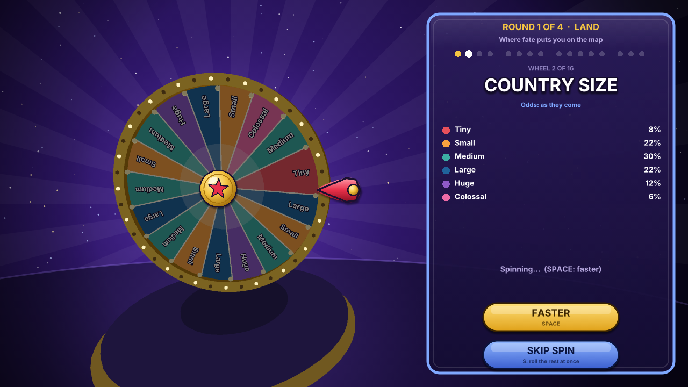
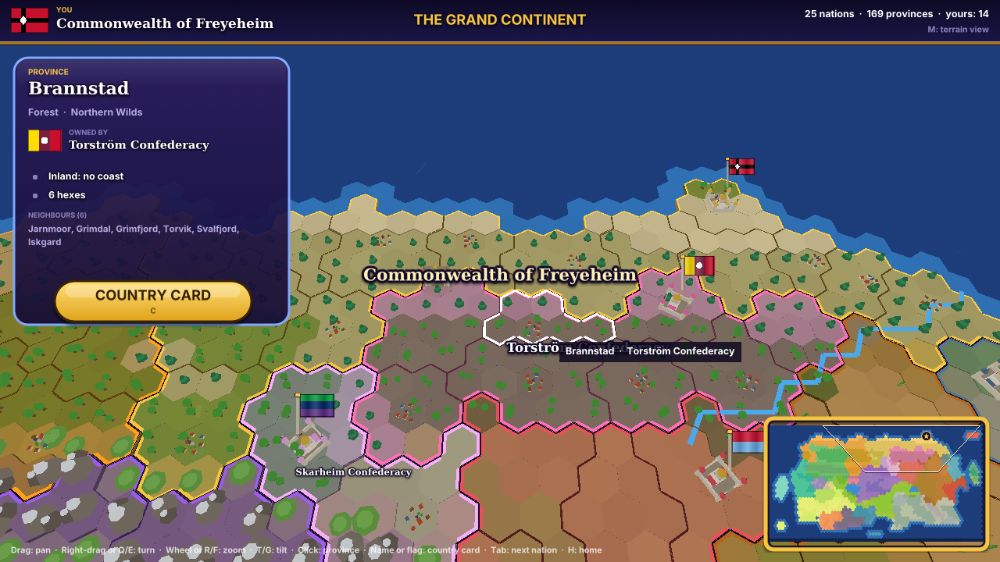
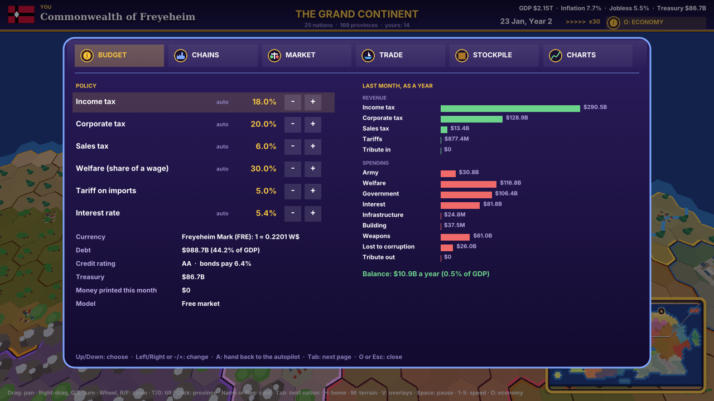
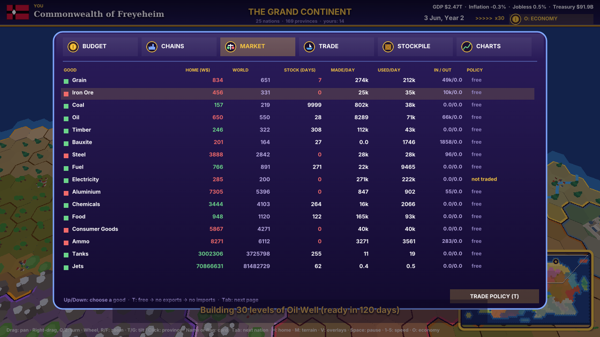
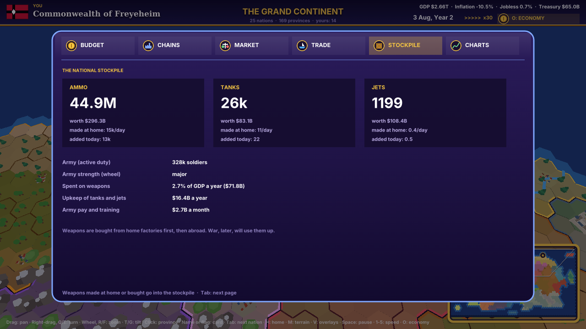
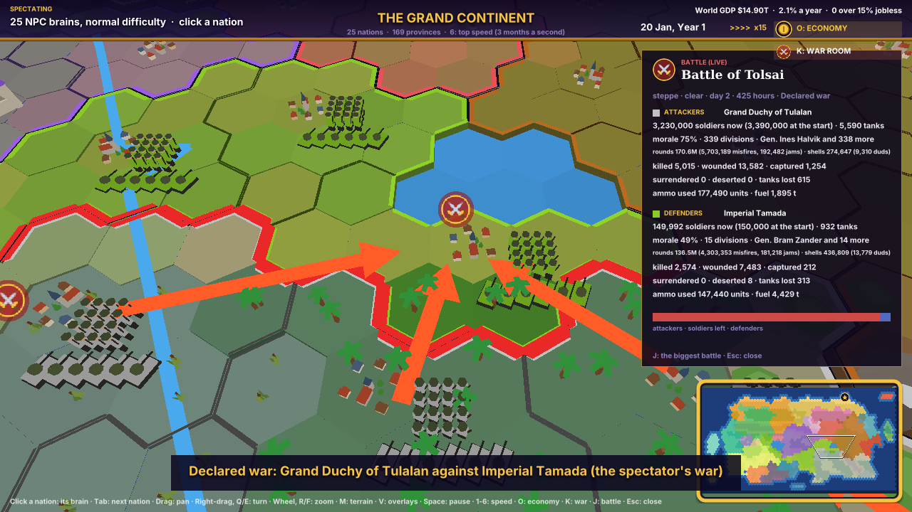
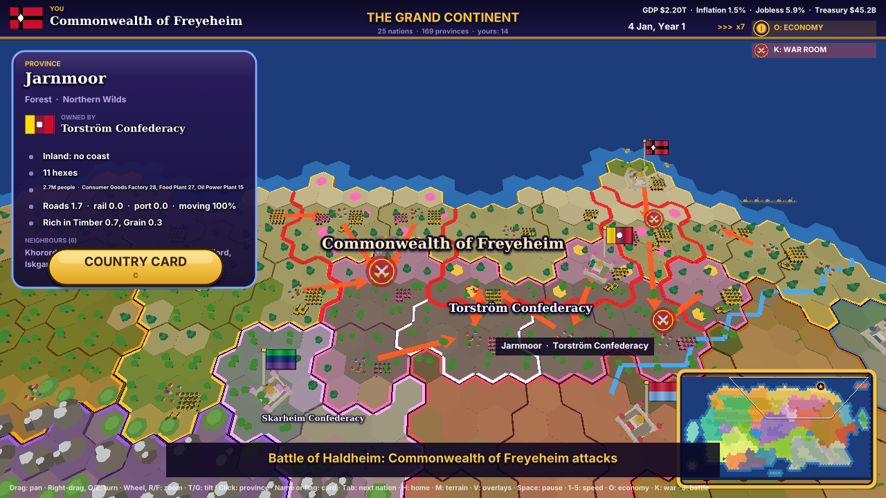
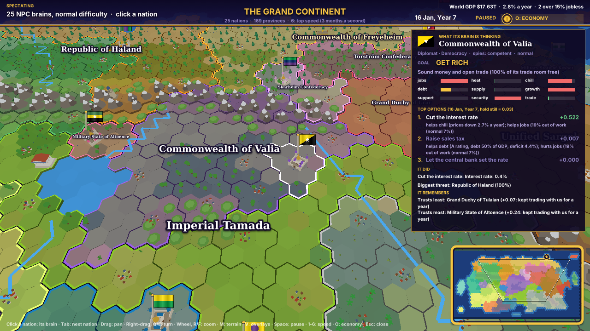

# LUCKY WORLD

A mostly-3D strategy game where fate deals your nation. At the start you spin
**16 wheels** to find out who you are: where you live, how many people you
have, how rich and how armed you are, who leads you and what luck follows
you. Then every rival nation spins the same wheels, and the game begins.

So far it has **the wheel screen** (phase 1), **the 3D world map**
(phase 2), with every nation laid on one of three hand-made maps from its
wheels, and **the economy** (phase 3): a living, daily simulation of 16
goods in production chains, jobs, wages, prices, money, budgets, debt,
currencies and world trade for every nation, on a game clock. And
**the NPC brains** (phase 4): every nation you don't run thinks for itself,
with the same levers you have, the same fog of war, and a personality from
its wheels. You can watch a world of brains only and read any one's mind.
And **war** (phase 5): divisions of soldiers and real equipment, fought
hour by hour with Lanchester's laws and dice, every shell from a real
factory (duds included), supply lines, air and sea, an escalation ladder
from border skirmish to total war, and peace deals. Diplomacy comes next. It is built with Duck Forge (engine), Duck Quill
(art), Duck Echo (sound) and Duck Mold (3D models).

<p>

















</p>

## Run it

You need [Rust](https://rustup.rs) 1.87 or newer. From this folder:

```sh
cargo run --release
```

The first build downloads Duck Forge from GitHub and takes a few minutes;
after that it starts in seconds. Always run it **from this folder**: it reads
`data/` and `assets/` from here.

### If it runs slowly

The world map is drawn by your graphics card (it uses no CPU-only
effects). The wheel screen's smooth edges are worked out on the CPU. `lucky_world.tune.json`
sets the picture quality. A running game re-reads it when you save it:

```json
{"supersample": 2, "bloom": 0}
```

- `supersample` 1 turns smoothing off and lets the graphics card draw the
  3D: fastest.
- `supersample` 2 is the default; 3 or 4 is smoother still.
- `bloom` 1 adds a real glow halo round the bulbs and the winning slice:
  pretty, but costly.

### Controls

| Screen | Keys | Mouse |
|---|---|---|
| Title | Left / Right or 1-3 choose a world, **Space** spin, **S** Skip Spin, **W** watch a world of NPC brains | click a world, click the buttons |
| A wheel | **Space** spin (while spinning: faster), Space again for the next wheel, **S** Skip Spin | buttons |
| Round card | **Space** next round, **S** Skip Spin | buttons |
| Country card | **Space** meet your rivals | button |
| Rivals | 1-9 or click a nation for its full card, Esc or Space back, Left / Right turn pages, **Space** Begin | click a card |
| World map | WASD / arrows pan, Q / E turn, R / F zoom, T / G tilt, Tab next nation, H home, M terrain / nations view, **V** resources / industry overlay, C country card, Esc deselect | drag pans, right-drag turns, wheel zooms, click a province, click a name or flag for its country card, click the minimap to jump |
| The clock (map) | **Space** pause, **1-5** speed (1, 3, 7, 15 or 30 days a second); watching, **6** (90) | |
| Economy window (map) | **O** open / close, **Tab** next page, Up / Down choose a row; Budget: Left / Right lower / raise (taxes, welfare, tariff, rate, research, arms, public works), **A** back to autopilot; Chains: **B** build, **X** close, **R** a road where goods are stuck, **P** a port; Market: **T** trade policy; Trade: **X** embargo | click the ECONOMY button, the pages, rows, −/+ and the buttons |
| Watching (map) | click a nation's name or a province, or **Tab**: its brain panel; Esc closes it | |
| War (map) | **K** the war room, **J** jump to the biggest battle, **V** (third press) the war overlay, Enter: the last battle's full report, Esc closes a battle panel | click the crossed swords on a battle to watch it, the WAR ROOM button |
| War room | **Tab** next page, Up / Down choose; Wars: **E** escalate, **M** match, **B** back down, **P** offer peace, **Y** / **N** answer their offer, **D** declare on the selected nation, **L** the level; Army: **A** attack, **H** hold, **G** dig in, **R** retreat, **F** reinforce the selected province, **U** back to the general; Supply: Left / Right a front's priority, **Y** / **N** a request, **T** Auto; Reports: **Enter** the full report | click the pages |
| Anywhere | **F5** start over (for trying it out), **Esc** quit, F12 screenshot, F10 record | |

### What happens

1. **Choose a world**: one of the 3 premade maps (The Grand Continent,
   The Thousand Isles, Five Shores).
2. **Spin 16 wheels in 4 rounds**, each round ending with a summary card:
   - **Land**: Continent, Country size, Landlocked or coastal, Land type
   - **People**: Population, Human development, Ideology, History
   - **Power**: GDP, Main resource, Army strength, Active duty, Secret service
   - **Fate**: Leader, Regional impact, Blessing or curse
3. **Your country card**, with a generated name and flag and all 16 results.
4. **The rival reveal**: the map's rivals spin the same wheels (instantly),
   everyone is placed on the map, and more nations spin to fill the empty
   land, up to 25 in all. All of them are shown, on pages if needed.
5. **Begin** takes you onto **the 3D world map**: provinces, borders in each
   nation's colour, names, flags, capitals, towns, landmarks, rivers, a
   minimap, and a panel for any province you click.
6. **The clock runs**: one tick is one day. Every nation's economy lives
   (see below), news pops up, and you run yours from the economy window.

### The world

The three maps play differently:

- **The Grand Continent**: one big landmass (169 provinces), long land
  borders, a lake and two mountain ranges in the middle, a few islands.
- **The Thousand Isles**: 25 islands (94 provinces); every nation has a
  coast, and island nations have the sea all round.
- **Five Shores**: five continents and an island chain (147 provinces), from
  the frozen north to the desert of Sahrun round its Oasis Sea.

Each map is a hex grid of terrain (plains, forest, jungle, desert, steppe,
tundra, hills, mountains, marsh, glacier, lakes, shallow and deep sea),
rivers and landmarks, split into provinces. Every province knows its
terrain, whether it is on the coast, its neighbours, its rivers and its
continent; later phases build on these.

Nations are placed from their wheels:

- **Continent**: where it sits.
- **Country Size**: how many provinces, as a share of this map
  (`data/world.toml`), so "Huge" is huge for the map you play.
- **Landlocked / Coastal / Peninsula / Island Nation**: its border.
  Landlocked nations never touch the sea; island nations take a whole
  island and share no land border.
- **Land Type**: it prefers provinces of that terrain.

Island nations go first, then landlocked ones, then the rest, bigger
before smaller. The player gets no favours. When the land can't give a
nation what it rolled (no free island the right size, say), the card says
so in blue. Then extra nations roll the same 16 wheels for the biggest
empty stretch, until the land is covered or there are `max_nations`. Land
still left joins a neighbour, and stray islets join the nearest nation
across the sea.

Each slice's size **is** its chance, and the panel lists the exact odds. The
wheels are linked: Continent is spun first, and later wheels follow from
earlier ones. The panel's "Linked to" line names the results that shaped
each wheel. For example:

- nobody on an island continent (the whole Thousand Isles map) is landlocked;
- population follows the country's area and land;
- GDP is population times income per person (from HDI), with a rare golden
  "Tiny but Rich!" slice that only small countries can land on;
- army strength follows GDP and population, and active duty follows how big
  the army is next to what the economy can pay for (a junta with a big army
  and a small economy puts many people in uniform); no army means 0% on duty;
- only one nation per world can have the World's Strongest army, and one
  Regional Power per continent.

**Skip Spin** rolls every wheel that's left at once, with the same odds and
links. Mid-spin it keeps the result the wheel was heading for.

### The economy

Every nation has a real economy, simulated day by day (the full design,
with the math, is [docs/ECONOMY.md](docs/ECONOMY.md)):

- **16 goods in chains**: grain, iron ore, coal, oil, timber and bauxite are
  dug and farmed; power, steel, fuel, aluminium and chemicals are refined;
  food, consumer goods, ammo, tanks and jets are made. Buildings sit in
  provinces and need workers, skill, power and inputs; they scrap a share as
  defects. **Break a link and everything after it slows or stops.** Roads,
  rail and ports limit what each province can move.
- **People and jobs**: farming, mining, industry, services, government and
  the army; wages, unemployment, and needs for food, goods and luxuries.
  Shortages and joblessness lower happiness and stability.
- **Money and the state**: taxes in; army, welfare, government,
  infrastructure, building and weapons out. Deficits become debt with a
  credit rating; past the rating's ceiling, money is printed and the
  currency falls. A central bank sets interest rates. Each nation has its
  own currency.
- **Markets and trade**: prices from supply and demand; a world market with
  exchange rates, tariffs and embargoes; coastal nations trade cheaply by
  sea, landlocked ones pay more overland.
- **Every wheel has an economic job**: the wheels set day 1 (its GDP is the
  wheel's), the land and resources decide what a nation makes well, and the
  ideology sets the model: Communism plans (quotas, shortages), Democracy is
  a free market, the rest are mixed, and colonies pay tribute to an
  overlord. History, leader, HDI and blessing or curse all have effects, in
  `data/economy/effects.toml`.
- **Luck and rot**: booms, crashes, discoveries, bad harvests, factory fires,
  strikes, earthquakes and oil shocks; corruption and the black market.
- **Your nation runs on an autopilot** (central bank, taxes, investment,
  infrastructure, trade) until you take a lever of your own. Every other
  nation is run by its brain.

Everything is in `data/economy/*.toml` (goods, buildings, effects, events,
currencies and every constant in `settings.toml`), read when the game starts.

### The NPC brains

Every nation you don't run has a brain (the full design, with the math, is
[docs/AI.md](docs/AI.md)). It thinks in three layers:
- **Strategy**, every three months: how strong everyone is, who is its
  biggest threat, whether someone (perhaps you) is too strong for comfort,
  which weak neighbours could be opportunities, and its goal: grow, get
  rich, dominate or survive.
- **Planning**, every week: every action it could take (taxes, welfare,
  tariffs, the rate, research, arms, public works, building and closing, roads, ports,
  export bans, embargoes) gets a score for how much it helps its goal now.
  It takes the best, or holds still if nothing beats that.
- **War** (phase 5): whether to start one, how far to escalate, when to
  match or back down and when to make peace (below).

**Fair play.** A brain uses only the player's own buttons, with the same
costs and limits. It sees its own country fully, but other nations only
through its secret service, with errors (a legendary service guesses within
4%, none within 30%). There are no bonuses: difficulty is how well it plans.
**Personality** comes from the wheels: a warlord takes risks, a coward is
careful, a genius plans further ahead, a builder loves industry, a diplomat
loves trade. A democracy needs public support, military rule loves its army,
communism plans, and a colony resents its overlord. **Memory**: each brain
remembers who embargoed it, who kept trading and who cut it off, ready for
diplomacy and war.

Over 50 years on all three maps and twelve seeds (36 worlds), brains beat
the phase 3 autopilot on all three yardsticks:

| | Autopilot | Brains |
|---|---|---|
| World growth a year | 0.84% | **2.36%** |
| Nations above 15% unemployment | 426 of 900 | **203** |
| Junk credit ratings | 241 | **138** |

**Spectator mode**: press **W** on the title (or start with
`-- --spectate grand`). A world of brains only runs at up to three months a
second; click any nation to see its goal and why, its needs, its three best
options with their scores and reasons, what it did, its threats and what it
remembers.

The weights are all in `data/ai/brain.toml` and `data/ai/personality.toml`.
The tools that tuned them:

```sh
cargo run --release --no-default-features -- --ai-compare 50 1 2 3 4 5 6   # brains against the autopilot
cargo run --release --no-default-features -- --ai-tune 100 30              # 100 NPC worlds: dumb behaviour
cargo run --release --no-default-features -- --ai-trace grand 1 4 720      # one brain's weeks
```

To see how the world does without you:

```sh
cargo run --release --no-default-features -- --economy-report 50
cargo run --release --no-default-features -- --economy-report 50 --map isles --world-seed 3
```

It prints every nation's model, people, GDP then and now, growth, GDP per
head, inflation, unemployment, debt, rating, stability, trade and top export,
then the world's prices and the latest news (50 years of 25 nations take
about 4 seconds; a full run of all three maps is in
[docs/economy_report_50y.txt](docs/economy_report_50y.txt)).
`--economy-trace MAP NATION DAYS EVERY` follows one nation
day by day (`--detail`, `--budget`, `--world`, `--good ID` and `--cpi` show more).

The balance rules (no nation over $300k a head, no 5-year spell over 25%
unemployment, world inflation between -3% and 8% every year, never more than
2 nations over 15% inflation at once, no collapses) can be checked on any
seeds:

```
cargo run --release --no-default-features -- --economy-health 50 1 2 3 4 5 6 7 42 --why
cargo run --release --no-default-features -- --economy-world isles 5 600
```

(see [docs/ECONOMY.md](docs/ECONOMY.md), section 14, for the rules and the
before and after of the balance pass).

### War

Every army is made of **divisions** of 10,000 soldiers (armoured ones
with 200 tanks), raised from the active-duty wheel and the population,
each with training, experience, morale, a general (skill and style) and
an **equipped %** (rifles, ammo, food, and for tanks fuel). The full design
and the math are in [docs/WAR.md](docs/WAR.md).

- **Combat, every hour**: shots fired × accuracy × training × terrain ×
  weather × general × air × supply × morale × dice = hits; each hit is
  killed, wounded or captured. Frontage limits who can fight, so cover
  turns Lanchester's square law towards the linear one. Mountains, rivers,
  forests, marshes and cities matter a lot.
- **Every round counts**: weapons come from the economy's factories with a
  **defect rate** set by factory quality, so rifles jam, shells are duds
  and tanks break down. Every round and shell fired comes out of the
  stockpile. Morale falls with losses, shortages, bad generals, defeats
  and war exhaustion; past the breaking point divisions retreat,
  surrender or desert. Tanks without fuel are abandoned and captured.
- **Supply** runs from the capital along roads, rail and sea lanes; distance
  and enemy air cut what arrives. Generals ask for what they need in words
  ("Western front needs 200 tanks and 3 weeks of fuel"); you approve or
  deny (or leave it on Auto) and set each front's priority. Commanding the
  armies yourself is optional: the generals fight on their own.
- **Air and sea**: jets fight for air superiority (support, interdiction,
  bombing factories and rail); warships fight for sea zones, blockade,
  and carry invasions. Warships and transports are new goods built in
  coastal shipyards. Landlocked nations can't have a navy.
- **The escalation ladder**: cold war, border skirmish, military
  operation, declared war, total war, plus proxy wars, civil wars and
  blockades. Either side can escalate; the other matches or backs down.
  Military rule escalates easily; a democracy needs its people behind it.
- **Peace** by war score: white peace, reparations, provinces, a vassal or
  a new government; prisoners go home. The dead leave the population,
  ruined factories and rail must be rebuilt.
- **The brains go to war** with the same rules and the same fog: warlords
  and military rule are aggressive, cowards and democracies avoid war, and
  everyone gangs up on whoever gets too strong, you included.

Over 50 years on all three maps and six seeds (18 worlds, 450 nations):

| | Grand Continent | Thousand Isles | Five Shores | All 18 worlds |
|---|---|---|---|---|
| Wars (cold wars not counted) | 195 | 118 | 162 | **475** (0.21 a nation per decade) |
| Battles | 1,854 | 495 | 1,483 | **3,832** |
| Soldiers killed | 987,675 | 231,730 | 911,183 | **2.13 million** |

- **How far they went**: 239 stayed border skirmishes, 45 military
  operations, 162 declared wars, 29 total wars; also 18 cold wars and 24
  wars with proxy suppliers.
- **How they ended**: all 475 in peace. 207 skirmishes went quiet, 101
  surrenders, 83 white peaces, 53 peace deals, 27 operations reached their
  goal, 4 ended with one side backing down from an escalation.
- **The world doesn't burn down**: a nation spends 0.4 of 50 years at war
  on average, and at worst 16% of a world's nations were at declared or
  total war at once.
- **Weak spots, honestly**: 136 of the 475 wars (29%) never had a battle:
  79 skirmishes that stayed a stand-off, and most of the rest wars across
  the sea that neither side had the ships to fight. There were no civil
  wars in these 18 worlds (stability rarely stays under 20 for 45 days);
  the civil-war code is covered by its tests and showed up in other runs.

```sh
cargo run --release --no-default-features -- --war-report 50 1 2 3 4 5 6 --battles   # every war, and the bloodiest battle of each world
cargo run --release --no-default-features -- --war-battle grand 1                    # one battle, hour by hour (add "sea" for an invasion)
cargo run --release --no-default-features -- --war-world isles 2 20                  # one world's wars
cargo run --release --no-default-features -- --spectate-war grand                    # watch a war from the first shot to the peace
```

The full 50-year report is [docs/war_report_50y.txt](docs/war_report_50y.txt).

## Tune the wheels

Everything about the wheels is in plain text files. Edit them and run the
game again; no rebuild is needed.

- `data/wheels.toml`: all 16 wheels: options, weights, colours, rules and
  links. Its header explains every kind of rule.
- `data/maps.toml`: the 3 maps, their continents and tags (island, cold,
  heartland...), and how many rivals each has.
- `data/names.toml`: name syllables per region, name forms per ideology
  ("Kingdom of {}"), and flag colours.

## Edit the maps

The maps are plain text too, read when the game starts (no rebuild):

- `data/maps/<map>.txt`: the terrain, one letter per hex. Odd rows sit half
  a hex to the right. The letters are in `data/terrain.toml`, with each
  terrain's colour, height, Land Type and decoration (trees, palms,
  peaks...).
- `data/maps/<map>.toml`: the provinces. Each is a name, a continent and
  the hex it is centred on (`at = [column, row]`). Every land hex belongs to
  the province nearest it over land, so moving `at` moves the borders, and
  adding a province splits its neighbours. The file also holds the rivers
  (a line of hexes ending in water) and the landmarks.
- `data/world.toml`: `max_nations` (25), the province share for each
  Country Size, the placement weights and the border colours.

A mistake (a letter that isn't a terrain, a province centred in the sea, a
continent the map doesn't have, a river that jumps) is one sentence with the
file, line and column. `tools/sketch_maps.py` is the sketch the maps were
first drawn from. Running it again overwrites them, so edit the map files
instead.

A mistake in these files is reported as one sentence naming the file and
the wheel. `cargo test` checks them too, and checks the promises above over
tens of thousands of rolled countries. To see how often each option comes
up on each map:

```sh
cargo test --release odds_report -- --ignored --nocapture
```

## The art, sound and model

| Source | Tool | Becomes |
|---|---|---|
| `art/*.json` | Duck Quill scripts | `assets/art/*.png` (pointer, hub, glow, sparkle, cards, buttons, logo, backdrop, RARE! badge; map: top bar, province panel, minimap frame, small cards, flag cloth and pole, capital, town, landmark and river icons; economy: the window and its six page icons; war: crossed swords, plane and army icons, the battle report's paper) |
| `sound/*.toml` | Duck Echo recipes | `assets/sound/*.wav` (two ticks, land chime, whoosh, rare sting, card swoosh, fanfare; map: a seamless sea-and-wind ambience loop, click, select, open-map swell, zoom tick; economy: coin, month chime, news sting; war: gunfire, an explosion, a 12-second war-drum loop) |
| `models/*.toml` | Duck Mold recipes | `assets/models/*.glb` (the wheel's stand; capital, town, tree, pine, palm, cactus, peak, hill, reeds; landmarks: lighthouse, pyramid, great tower, temple, arch, colossus; war: soldier, tank, jet, warship and transport, each with one part in the nation's colour) |

The wheel itself is built in code from triangles, because its slices change
with every spin. Its labels are text painted onto textures.

The built files are committed, so the game runs without the tools. To
rebuild them after changing a source, build the three tools and run:

```sh
QUILL=path/to/quill DUCK_ECHO=path/to/duck-echo DUCK_MOLD=path/to/duck-mold tools/make_assets.sh
```

## Without a screen (servers, checks, CI)

```sh
cargo test --release --no-default-features
cargo run --release --no-default-features -- --headless --inputs playthroughs/lucky_world.json --sheet-events --out out/look
cargo run --release --no-default-features -- --headless --inputs playthroughs/economy.json --sheet-events --out out/economy
cargo run --release --no-default-features -- --headless --inputs playthroughs/spectator.json --sheet-events --out out/spectator
cargo run --release --no-default-features -- --headless --inputs playthroughs/war.json --sheet-events --out out/war --spectate-war
cargo run --release --no-default-features -- --headless --inputs playthroughs/war_player.json --sheet-events --out out/war_player
cargo run --release --no-default-features -- --fuzz 40
cargo run --release --no-default-features -- --economy-report 50
```

The playthrough spins all 16 wheels and opens a rival's card. It presses
Begin, then on the map it visits nations, clicks a province, opens and closes
a country card, pans, zooms, tilts and switches views. The fuzz runs reach
the map too. The economy playthrough runs the clock at full speed, opens
every page of the economy window, raises a tax, builds, and shows both
overlays. The spectator playthrough watches a world of brains for seven
years at top speed and opens five nations' brain panels. The war
playthrough watches a declared war from the first shot to the peace: it
zooms into the biggest battle, opens every page of the war room, reads a
battle report and shows the war overlay. The player's war playthrough
clicks a neighbour, declares war, orders every front to attack, turns
supply Auto off, approves a general's request, reads a report and offers
peace. For the map's, the
economy's and spectator mode's own keys:
`-- --fuzz 40 --fuzz-keys S,Space,Enter,Left,Right,Up,Down,Tab,M,H,C,Q,E,R,F,T,G,W,A,D,O,V,B,X,P,Digit1,Digit5,Digit6,Escape`; with the war's keys too:
`--fuzz-keys S,Space,Enter,Left,Right,Up,Down,Tab,M,H,C,O,V,K,J,E,B,P,Y,N,D,L,A,G,U,T,R,F,X,Digit5,Digit6,Escape`.
`out/look/sheet.png` shows the run, and `audio.wav` has every tick.

## Files

| | |
|---|---|
| `src/data.rs` | Reads and checks the TOML files |
| `src/fate.rs` | The odds of each wheel given the earlier results, rolling a result |
| `src/country.rs` | A country: results, name, flag, numbers in words; rolling rivals |
| `src/wheel.rs` | The 3D wheel: slices sized by odds, labels, the spin, ticks, the glow |
| `src/game.rs` | The screens: title, wheels, round cards, country card, rivals |
| `src/game/map_screen.rs` | The world map screen: camera keys and mouse, picking, names and flags, province panel, minimap |
| `src/game/econ_screen.rs` | The clock, the economy window (budget, chains, market, trade, stockpile, charts), the map overlays |
| `src/game/brain_panel.rs` | Spectator mode's brain panel |
| `src/game/war_screen.rs` | War on the map: armies, fronts, arrows, battle markers and the live battle panel, the war room (wars, army, supply, reports), battle report cards, war sounds |
| `src/war/` | The war, which never draws: `data.rs` (reading `data/war/war.toml`), `mod.rs` (divisions, generals, wars, the daily loop), `land.rs` (hourly combat, moving, occupying, the generals), `supply.rs` (supply lines, requests, recruits, hospitals, desertion), `air.rs`, `sea.rs` (zones, fleets, blockades, invasions), `escalation.rs` (the ladder, exhaustion, civil, proxy and cold wars, the brains' war decisions), `peace.rs` (war score, terms, the `PeaceTable` hook), `player.rs` (the war room's commands), `report.rs` (battle reports, `--war-report`), `tests.rs` |
| `data/war/war.toml` | Every number of the war, each explained in docs/WAR.md |
| `docs/WAR.md` | The war's design, with the math, and the 50-year results |
| `src/ai/` | The NPC brains, which never draw: `data.rs` (reading `data/ai/`), `mod.rs` (personality, brains, the daily loop), `strategy.rs` (intel, power, threats, hegemon, opportunities, the goal), `planning.rs` (needs, actions, scores, acting through the player's levers), `memory.rs` (relations, war memories), `battle.rs` (an old hook; the war's generals are in `src/war/land.rs`), `report.rs` (compare, tune, trace), `tests.rs` |
| `docs/AI.md` | The brains' design, with the math, and the before and after |
| `src/econ/` | The economy, which never draws: `data.rs` (reading `data/economy/`), `init.rs` (day 1), `tick.rs` (one day), `market.rs` (world trade), `policy.rs` (events and the autopilot), `player.rs` (the player's levers), `report.rs` (the report), `tests.rs` (its promises) |
| `docs/ECONOMY.md` | The economy's design, with the math |
| `src/hex.rs` | Hex grid maths: neighbours, corners, which hex a point is in |
| `src/mapdata.rs` | Reads and checks the maps; works out provinces, coasts, neighbours, rivers, landmasses |
| `src/world.rs` | Who owns what: placing nations from their wheels, filling the land |
| `src/map_view.rs` | The 3D map's meshes (terrain, sea, borders, rivers, trees, cities), the orbit camera, picking |
| `src/ui.rs` | Loading assets, text, buttons, sparkles and confetti |
| `src/tests.rs` | Data checks, linking rules over many countries, map and placement rules, play tests |
| `ISSUES.md` | Problems and missing features found in the four Duck tools |
